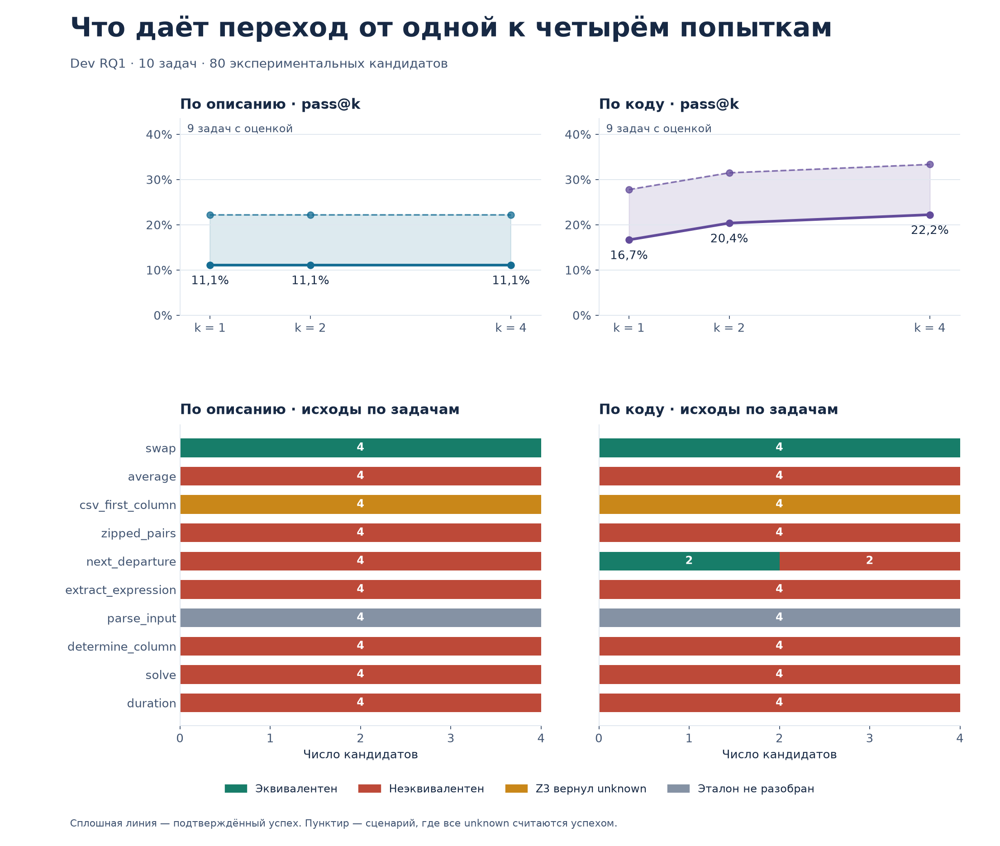

# RQ1. Результаты пилота и план исследования

Материал для встречи с научным руководителем · 24 ноября 2026 г.

В пилоте Dualify сохранил 100 контрактов по десяти задачам. Диагностические метрики рассчитаны по девяти задачам. На десятой проверка остановилась при разборе самого эталона. По коду средняя вероятность найти подтверждённый контракт выросла с **16,7% до 22,2%**, при переходе от одного случайного кандидата из экспериментального пула к проверке всех четырёх. Прирост составил **5,6 процентного пункта**. Весь прирост пришёлся на `next_departure`. По описанию прирост по подтверждённым совпадениям составил **0 п.п.** Перед итоговым прогоном на 30 отдельно отложенных задачах нужно решить, как учитывать непроверяемые эталоны и насколько основной результат диплома должен зависеть от ограничений исходного проверяющего модуля. [Freeze dev](../artifacts/dev-2026-11-22-vpn-freeze.json) · [Поштучные результаты в архиве](../artifacts/dev-2026-11-22-vpn.tar.gz)

## 1. Что проверяет RQ1

Цель диплома — изучить, как улучшить получение формальных контрактов из описаний и кода. В RQ1 проверяем, насколько вероятнее найти хотя бы один контракт, эквивалентный эталону, среди четырёх попыток одной модели по сравнению с одной попыткой при тех же настройках. Контракт состоит из предусловий, которые задают допустимые входы, и постусловия, которое ограничивает допустимый результат для этих входов. Dualify — исследовательский инструмент, который независимо строит контракт по текстовому описанию функции или по её коду. Например, контракт перестановки двух элементов связывает первый элемент результата со вторым элементом входа и второй с первым. [Протокол RQ1](../RQ1.md) · [Эталон перестановки](../../../benchmark/lifted/crosshair_examples_PEP316_correct_code_arith.py_swap.yaml)

```text
Описание функции или фрагмент Python
  → LLM формирует контракт в JSON
  → Dualify нормализует формулы, проверяет их и при необходимости запрашивает repair
  → сохраняется итоговый контракт
  → offline-проверка Z3 сравнивает контракт с эталоном (gold)
  → статусы попыток агрегируются в pass@k
```

В конце работает oracle, модуль оценки. Он переводит формулы в язык Z3, решателя логических ограничений, и ищет вход или результат, на котором контракты расходятся. Подтверждённое совпадение относится к свойствам, выраженным в эталоне и переводимых в поддерживаемый формальный язык. Например, эталон может проверять длину списка, оставляя значения элементов свободными. RQ1 измеряет наличие совпадения в пуле, а для возврата одного подходящего контракта понадобится отдельный способ выбора. [Gold scoring](../../../src/dualify/gold_scoring.py#L216-L253) · [Сравнение формул](../../../src/dualify/phases/p03_smt_checking.py#L503-L554)

`Pass@k` — вероятность встретить хотя бы одно подтверждённое совпадение в случайной подвыборке из *k* кандидатов. В пилоте для каждой пары «задача и канал» брали четыре сохранённых попытки. Если две из четырёх успешны, случайный одиночный кандидат успешен в половине случаев. Из шести пар только одна состоит из двух неуспешных кандидатов, поэтому `pass@2 = 5/6`. При выборе всех четырёх успех гарантирован для этого пула. Доли сначала считали внутри задач, затем усредняли с одинаковым весом. Рост с *k* следует из определения метрики. Исследовательский результат — размер прироста, разброс по задачам и затраты. Вероятность нового прогона за пределами сохранённых пулов требует дополнительных предпосылок о генерации и составе задач. [Chen и др., 2021, § 2.1 и приложение A](https://arxiv.org/abs/2107.03374) · [Формулы протокола](../RQ1.md#6-статистическая-оценка-и-формулы)

## 2. Как был устроен пилот

В дипломной версии появился исследовательский слой вокруг штатных извлекателей p01 для описания и p02 для кода. Он запускает полный цикл извлечения для каждого заранее назначенного слота, сохраняет итог, доступные ответы и время, а затем позволяет пересчитать оценку без обращения к модели. Gold используется на этапе оценки. Один слот, или полная попытка, охватывает первый ответ и при необходимости до двух новых логических вызовов для восстановления контракта. Клиент может отправить один логический вызов повторно при временном сбое HTTP. [Адаптер попытки](../../../src/dualify/rq1_attempt.py#L66-L219) · [Запись и чтение пула](../../../src/dualify/rq1_pool.py#L216-L319)

Из 40 исходных пар Python и gold заранее выделили 10 dev и 30 held-out задач с seed `20261120`. На каждую dev-задачу пришлось по пять попыток на канал, всего 20 контрольных и 80 экспериментальных. Контроль (baseline) использовал начальную температуру 0. Экспериментальная серия (treatment) использовала температуру 0,7 в четырёх отдельных первых вызовах. Во всех repair температура была 0. Сравнение `pass@4 − pass@1` проводится внутри treatment, при одной температуре, а контрольная попытка служит отдельным ориентиром. [Манифест split](../benchmark-manifest.json) · [Протокол](../RQ1.md) · [Конфигурация dev](../TICKET_05_DEV.md#конфигурация-groq)

Модель — `qwen/qwen3.8-27b` на Groq, endpoint `/openai/v1/chat/completions`, `reasoning_effort=none`, `response_format=json_object`, `top_p` оставлен по умолчанию (1), максимум 1024 выходных токена и таймаут HTTP 120 с. Клиент выдерживал минимум 18 с между POST и допускал до двух физических отправок при временных сбоях. Лимит Z3 составляет 5 с на отдельную проверку solver. После дневного ограничения Groq прогон завершали в два этапа и сохранили первые 65 результатов. Отдельная отклонённая попытка возобновления с HTTP 403 записана вне журнала из 261 POST. [Отчёт о запуске](../TICKET_05_DEV.md) · [Диагностика HTTP 403](../artifacts/dev-2026-11-22-resume.json) · [Таймаут Z3](../../../src/dualify/phases/p03_smt_checking.py#L453-L462)

Первоисточник Dualify — commit `7ffd1ae37822096d5b7b573785ee46e877903185`. Ревизии генерации dev — `c8d559bef7c47a87d44e6bca0245cbdf30b6665e` и `b11301cb0d77fcbd4fa95b7ac24c4e203bcc5e74`. Материал и новые offline-проверки опираются на checkout `96f4896da31433dad46d2876e4efef181e579a03`, Python 3.14.4 и `z3-solver` 4.16.0.0. SHA-256 архива сверена с freeze, SHA-256 десяти dev-входов и эталонов — с архивным preflight. [Freeze и SHA-256](../artifacts/dev-2026-11-22-vpn-freeze.json) · [Архив с конфигурацией и данными](../artifacts/dev-2026-11-22-vpn.tar.gz)

## 3. Что показали 100 попыток

Завершились **100 из 100** запланированных попыток. Этот итог включает baseline и treatment. Классифицированы 90 результатов. Из них 13 эквивалентны, 67 доказанно расходятся с эталоном, а 10 получили `unknown`: Z3 не завершил логическую проверку. Все десять `unknown` относятся к `csv_first_column`. Ещё 10 исходов получили `unclassified`: Dualify не смог разобрать gold задачи `parse_input` и завершил сравнение до solver. Поэтому полный официальный расчёт остался заблокирован (`BLOCKED`). Таблица ниже использует 72 treatment-слота девяти задач, по четыре на задачу и канал. [Итоговый freeze](../artifacts/dev-2026-11-22-vpn-freeze.json) · [Статусы и формулы в архиве](../artifacts/dev-2026-11-22-vpn.tar.gz)

| Канал, 9 задач | pass@1 | pass@2 | pass@4 | Подтверждённый прирост 4 − 1 | Парный 95% интервал прироста |
| --- | ---: | ---: | ---: | ---: | ---: |
| Описание | 11,1–22,2% | 11,1–22,2% | 11,1–22,2% | 0 п.п. | 0–0 п.п. |
| Код | 16,7–27,8% | 20,4–31,5% | 22,2–33,3% | +5,6 п.п. | 0–16,7 п.п. |

В каждой ячейке `pass@k` нижняя граница засчитывает только доказанные совпадения, верхняя дополнительно засчитывает все `unknown`. Это чувствительность метрики к архивным статусам девяти задач. Отдельная проверка на фиксированном входе уже выявила расхождение у общего предусловия всех пяти кодовых финалов CSV. Таблица сохраняет их архивную классификацию. [Проверка предусловия CSV](02-dualify-z3-failure-analysis.md#exp-csv)

Доверительные интервалы отражают переотбор целых задач с возвращением (10 000 повторов, seed `20261120`) и рассчитаны по нижней границе. Для `pass@1` и `pass@4` интервалы по описанию оба составили 0–33,3%, по коду — 0–38,9% и 0–55,6% соответственно. Bootstrap по подтверждённым успехам не учитывает возможную переклассификацию `unknown`. По описанию нулевой интервал отражает девять нулевых вкладов в подтверждённый прирост. Для пула из четырёх неопределённых исходов сценарии «успешны все» и «успешных нет» дают нулевой вклад в прирост. В общем случае при одном успехе из четырёх вклад составляет 75 п.п. Для диагностического расчёта по всем десяти задачам при любом исходе непроверяемого пула диапазон `pass@4` расширяется до 10–30% по описанию и 20–40% по коду. Правило использования таких границ в основном отчёте ещё предстоит согласовать. [Формулы и bootstrap](../RQ1.md#6-статистическая-оценка-и-формулы) · [Архив поштучных статусов](../artifacts/dev-2026-11-22-vpn.tar.gz)



Верхние панели показывают pass@k по девяти задачам. В нижних видны и восемь treatment-слотов `parse_input`, оставшихся без оценки.

Таблица и график используют поштучные статусы из `scores`. В историческом поле `task_metrics` два из четырёх кодовых результатов `csv_first_column` учитывались иначе. Дополнительный offline-пересчёт сохранил четыре `unknown`, как в `scores`. Отличие затрагивает верхние кодовые оценки при *k* = 1 и 2, а причина расхождения между проходами пока открыта. У отдельного контроля при температуре 0 подтверждено 1/9 совпадений по описанию и 2/9 по коду, по одному `unknown` в каждом канале. Если брать первые слоты в порядке записи, по описанию подтверждённый успех встречается у 1/9 задач при каждом *k*. По коду получается 1/9 при *k* = 1 и 2 и 2/9 при *k* = 4. Эта диагностика зависит от порядка слотов. Таблица усредняет по всем возможным подвыборкам. [RQ1-013 в журнале багов](../../agent/KNOWN_BUGS.md) · [Диагностический архив](../artifacts/dev-2026-11-22-vpn.tar.gz)

Из 100 попыток 21 завершилась после первого вызова и 13 после обычного repair. Остальные 66 дошли до упрощённого repair. У четырёх приняли его ответ, у 15 сохранили часть постусловия, у 47 оставили пустое предусловие и заглушку `ret == ret`. Эти три последних исхода помечены `degraded`. Отметка описывает путь восстановления. У четырёх из этих 66 финалов подтверждена эквивалентность. Во всех четырёх treatment-слотах совпало сохранённое представление формул в пяти из девяти оценённых пулов по описанию и в шести из девяти по коду. Единица сравнения здесь — отсортированный список строк предусловий и строка постусловия. [Распределение исходов по задачам](../figures/dev-trace-outcomes.png) · [Подсчёт уникальных формул](../../../src/dualify/rq1_report.py#L100-L119)

**Затраты.** 100 попыток потребовали 245 логических вызовов, включая 145 repair. В журнале 261 физический POST: 243 ответа 200 с уникальными completion ID, два ответа 400 об ошибке формата модели и 16 ответов 429 с ограничениями провайдера. В успешных HTTP-ответах записано 251 857 входных и 51 113 выходных токенов. Медиана полной попытки 53,9 с, а медианы для одного, двух и трёх логических вызовов составили 18,0, 36,1 и 54,0 с. По описанию среднее число вызовов выросло с 2,31 для одного случайного кандидата до 9,22 для всех четырёх. Около 81 минуты заняли два активных запуска. Поле Groq `usage.total_time` имело медиану 0,413 с на успешный ответ. Оно исключает ожидание клиента между POST. Чистое время инференса, отдельная задержка Z3 и денежная стоимость не измерены. [График времени](../figures/dev-latency.png) · [Архив HTTP и результатов](../artifacts/dev-2026-11-22-vpn.tar.gz)

Выборка мала, часть задач близка по содержанию, а bootstrap переотбирает именно задачи. Формальные аннотации в некоторых исходных файлах могли облегчать генерацию. Пересечение benchmark с обучающими данными модели не измерялось. Один успешный смешанный пул и интервал прироста, включающий ноль, дают основание оценить стоимость и наблюдавшийся выигрыш. Для обобщения об эффективности или неэффективности повторного sampling на новых задачах пилота недостаточно. [Аудит входов](../TICKET_01_RISKS.md) · [Протокол статистической оценки](../RQ1.md#6-статистическая-оценка-и-формулы)

## 4. Где терялось качество

**Формула может передавать верную идею и выходить за пределы языка Dualify.** В `average` кодовый ответ `0039` записал вычисление `sum(numbers) / Length(numbers)` и непустоту `Length(numbers) > 0`. Валидатор не разрешает `sum`. После двух неудачных попыток repair исчезли оба свойства, а итог допускает любой результат и пустой список. Z3 предъявил именно пустой список как контрпример к равенству предусловий. Gold задаёт только диапазон между минимумом и максимумом. Для `[1, 3]` Python возвращает 2,0, а эталон допускает также 1 и 3. Здесь ограничения языка и ограниченный объём gold независимо влияют на оценку. [Архив, HTTP 0038–0042](../artifacts/dev-2026-11-22-vpn.tar.gz) · [Эталон average](../../../benchmark/lifted/crosshair_examples_deal_correct_code_average.py_average.yaml)

**Восстановление может оставить только слабую часть контракта.** Для `csv_first_column` модель сначала записала срез и неподдерживаемую стрелку `->`. В следующем ответе она сравнила символ строки с запятой. Dualify ввёл вызов `Char(',')` при нормализации и сам отклонил его. У третьего ответа лишняя скобка. Система сохранила требование наличия запятых и равенство длин списков, но потеряла связь между содержимым входной и выходной строк. Для `["a,b"]` итоговая формула допускает `["x"]`, gold требует `["a"]`. Это поясняющий пример. В архиве Z3 вернул `unknown` без контрпримера. В канале кода есть другой сбой CSV: одно и то же предусловие стоит во всех пяти финалах. В новом тесте с фиксированным пустым списком Z3 подтвердил, что его принимает gold и исключает кандидат. Исторические статусы сохраняются в исходных метриках. Offline-проверка выявила второй барьер. После разрешения `Char` предварительный проверяющий модуль всё ещё искажал формулу до передачи в Z3. На отдельном отрицательном контроле тот же дефект позволил пропустить выражение с несовместимыми типами. [Архив, HTTP 0058–0060](../artifacts/dev-2026-11-22-vpn.tar.gz) · [Эталон CSV](../../../benchmark/lifted/crosshair_examples_icontract_correct_code_showcase.py_csv_first_column.yaml) · [Проверка Char](02-dualify-z3-failure-analysis.md#exp-char) · [Проверка предусловия CSV](02-dualify-z3-failure-analysis.md#exp-csv)

**Проверка эталона может остановиться до вызова solver.** В `parse_input` функция возвращает два целых числа и строку. Переводчик Dualify представляет все три элемента как целые по типу первой позиции, поэтому `Length(ret[2])` ломает разбор даже при сравнении эталона с самим собой. Локальное представление кортежа с позиционными типами устранило сбой на эталоне. В этой проверке все десять сохранённых финалов задачи стали проверяемыми и разошлись с gold по предусловию. В первых ответах модели оставалась отдельная проблема, `Concat(lines)` с одним аргументом. Есть и вопрос к самому эталону. Для `["..", "#"]` код возвращает строку длины 3, а gold требует 4, поскольку подразумевает прямоугольную карту. [Эталон parse_input](../../../benchmark/lifted/python_by_contract_correct_aoc2020_day_3_toboggan_trajectory.py_parse_input.yaml) · [Дополнительная проверка типов](02-dualify-z3-failure-analysis.md#exp-tuple)

**Эталон может требовать домен или поведение, которых нет в видимом коде.** Для `duration` все пять кодовых попыток восстановили `ret == self_end - self_start + 1`. Oracle остановился на предусловии, поскольку gold требует упорядоченности дат, а в показанном модели теле проверки нет. По описанию все пять ответов записали ограничение дат, но пропустили `+1`. При равных датах эталон даёт 1, контракт по описанию даёт 0. В `solve` расхождение иного рода: на `[5, 5, 10]` с окном 2 код отвергает пару одинаковых значений и возвращает `(2, 10)`. Gold разрешает два одинаковых значения с разных позиций и по своему правилу требует отсутствие результата. Этот вход соответствует записанному gold-домену. [Архив, HTTP 0252–0261 и 0239–0241](../artifacts/dev-2026-11-22-vpn.tar.gz) · [Эталон duration](../../../benchmark/lifted/python_by_contract_correct_ethz_eprog_2019_exercise_05_problem_04.py_Entry_duration.yaml) · [Эталон solve](../../../benchmark/lifted/python_by_contract_correct_aoc2020_day_9_encoding_error.py_solve.yaml)

**Повторение помогает, когда исходы различаются.** В `swap` все четыре итоговые формулы совпали в каждом канале, и каждая прошла сравнение. В `next_departure` по коду два treatment-контракта из четырёх восстановили и нужное вычисление, и ограничение `min_time >= 0`. Два других не учли это ограничение. Подтверждённый `pass@k` на этой задаче вырос с 50% до 83,3% и 100%. Здесь же уже прошёл одиночный контроль при T=0. Основной выигрыш относится к выбору из treatment при T=0,7 и отражает совпадение с доменом gold. Поставляемый Python принимает время −1 при номере автобуса 1. По девяти оценённым кодовым пулам переход от одного кандидата к четырём поднял средние затраты с 2,47 до 9,89 логического вызова на задачу. [Архив, HTTP 0001–0017 и 0124–0131](../artifacts/dev-2026-11-22-vpn.tar.gz) · [Эталон next_departure](../../../benchmark/lifted/python_by_contract_correct_aoc2020_day_13_shuttle_search.py_next_departure.yaml)

## 5. Что следует для RQ1–RQ3

У пилота четыре разных критерия прогресса. **Качество генерации** улучшается, когда ответ точнее восстанавливает доступную семантику. **Проверяемость** растёт, когда та же формула переводится и получает определённый verdict. **Качество выбранного ответа** зависит от того, может ли selector найти подходящий контракт в пуле без эталона. **Сопоставимость с gold** зависит от того, какую часть поведения и какой домен фиксирует эталон. Пример `average` показывает, что более точное вычисление может быть сильнее gold. Пример `parse_input` показывает, что рост покрытия проверки возможен при тех же ответах модели. [Границы протокола RQ1](../RQ1.md#9-угрозы-валидности-и-обязательные-оговорки) · [Реестр ограничений Dualify](../../agent/KNOWN_DUALIFY_LIMITATIONS.md)

Для **RQ1** имеет смысл сохранить сравнение одной и четырёх попыток и заранее утвердить политику оценки. **RQ2** в дипломном протоколе означает выбор без gold. Малое разнообразие финалов ограничивает то, что можно выбрать, а `pass@k` задаёт ориентир доступности успешного кандидата. Для **RQ3** зафиксировано направление fine-tuning, в протоколе упомянут PEFT. Обучение может снизить долю синтаксических ошибок, но полезность такого обучения следует проверить. Оно требует согласованных целей, примеров и неизменной оценки. Исправление переводчика или эталона само по себе не проверяет эту гипотезу. Утверждённых отдельных методик и критериев RQ2/RQ3 в дипломных материалах не найдено. [Дипломный протокол](../RQ1.md) · [Решения о фиксированном split](../../agent/PROJECT_DECISIONS.md)

## 6. Следующие проверки

| Приоритет и проблема | Гипотеза и действие | Минимальная проверка, метрика и риск |
| --- | --- | --- |
| 1. Покрытие и интерпретация оценки | Зафиксировать оригинальный oracle для основного сравнения. Вывести покрытие, условный `pass@k` и сценарии для `unknown` и отсутствующей оценки. Сверить заявленный домен с исходным поведением на известных расхождениях. | Один offline-пересчёт 100 финалов с единой записью статусов и агрегатов. Проверить число оценённых задач, распределение причин и ширину границ. Анализ только оценённых задач может смещать результат, если непроверяемые задачи систематически сложнее. |
| 2. Тип смешанного кортежа | При отдельном согласовании проверить альтернативный перевод кортежа только на стороне оценки. Он даёт строковый тип третьей позиции. | Self-check `parse_input`, контроль неверной высоты и сравнение десяти финалов этой задачи уже выполнены. Следующая проверка охватит все 100 сохранённых финалов двумя oracle. Метрики — доля разобранных эталонов, переходы статусов и изменения покрытия. Это новая версия измерителя. |
| 3. Утрата формулы на repair | Исправить узкое место на одном шаге. Например, согласовать `Char` между нормализатором и валидатором, затем устранить дефект предварительной типизации отдельной проверкой. Для восстановления домена сначала проверить сохранение конкретного валидного конъюнкта. | Сначала тесты без сети на сохранённых ответах. Затем небольшой заранее утверждённый dev-пилот с фиксированным oracle, моделью, входами и одинаковым бюджетом логических вызовов. Сравнить долю прошедших типизацию, сохранность условий, частоту заглушек и подтверждённые успехи. Изменение способа repair или доступного контекста требует новой генерации для оценки причинного эффекта. |

Для проверки третьего направления сначала стоит выбрать один механизм. Пример `determine_column` допускает отдельный эксперимент с добавлением определения вспомогательной функции, но его следует проводить отдельно от изменений repair. В противном случае вклад каждого изменения будет неизвестен. [Вход determine_column](../../../benchmark/lifted_auto_eval/python_by_contract_correct_aoc2020_day_5_binary_boarding.py_determine_column.py) · [Технические эксперименты](02-dualify-z3-failure-analysis.md#diagnostics)

## 7. Решения на встрече и порядок работы

**До held-out нужны три решения.**

1. **Что измерять в главном результате?** Строгая эквивалентность исходному gold сохраняет сопоставимость. Отдельная проверка соответствия Python отвечает на другой вопрос и требует явно зафиксированного домена. Предложение — сохранить gold как основной критерий, а спорные случаи раскрыть в диагностике.
2. **Как отчёт должен учитывать сбои проверки?** Можно сохранить исходную блокировку либо заранее разрешить условную метрику с указанным покрытием и сценариями для всего набора. Если важна формальная проверяемость смешанных кортежей, нужно решить, будет ли отдельная версия oracle вторичной оценкой или новым основным протоколом.
3. **Когда результат dev достаточен для допуска?** Нужно согласовать минимально приемлемое покрытие оценки, порядок разбора нестабильных статусов и конфигурацию замороженного прогона. Отдельное разрешение пользователя на 30 held-out задач обязательно после фиксации этих решений. [Отложенный план](../tickets/heldout-test-and-report-deferred.md)

Далее стоит согласовать, нужен ли дипломный результат о качестве **одного возвращаемого контракта** и нужен ли эксперимент с **обучением**. Первый выбор задаёт объём RQ2 и критерий сравнения selector, второй — объём RQ3, обучающие данные и условия их разделения. Если на ближайшем этапе нужен только ответ о доступности подходящего контракта в пуле, достаточно закончить RQ1. [Границы RQ1 и дальнейших этапов](../RQ1.md)

После встречи сначала зафиксировать правило оценки и применить его к сохранённым финалам. Если согласована правка oracle, проверить её на тех же контрактах. Если требуется улучшить генерацию, провести ограниченный dev-эксперимент с одним изменением. Затем утвердить конфигурацию, критерии отчёта и порядок возобновления и запросить отдельное разрешение на held-out. Диагностика в этом материале выполнена offline, с **0 новыми LLM-вызовами**. Сравнения политик repair, дополнительного контекста и sampling при равном бюджете остаются предложенными экспериментами. [Технические проверки и команды](02-dualify-z3-failure-analysis.md#diagnostics)
