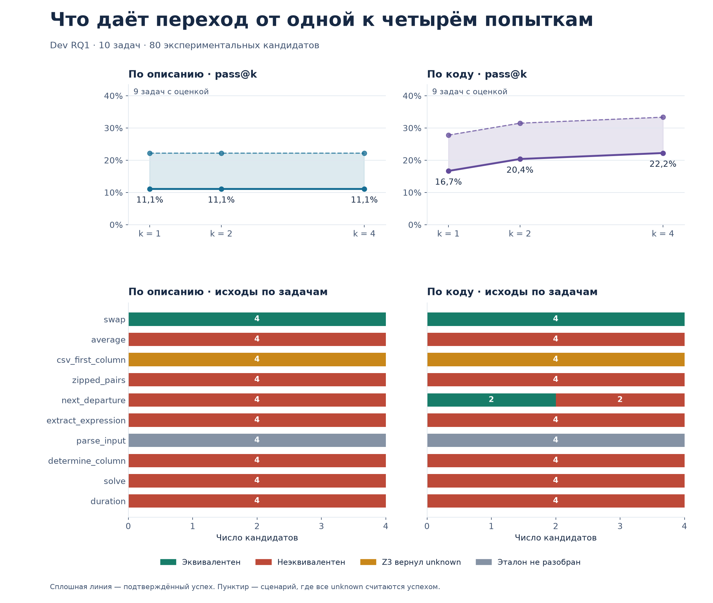
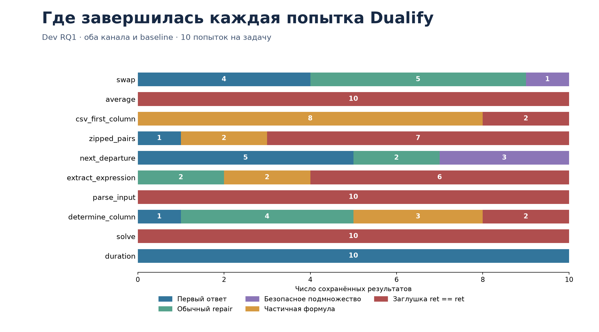
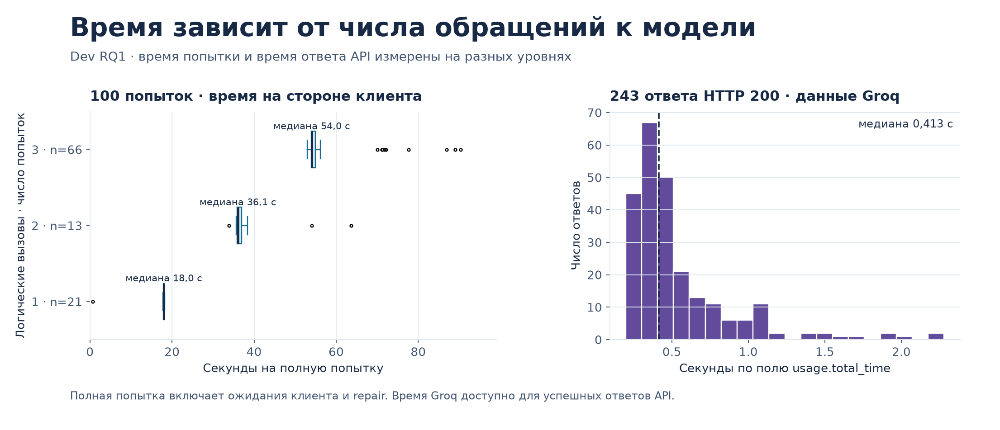

# 06 — Результаты dev и вопросы к руководителю

**Статус дев-этапа — `BLOCKED` на этапе оценки.** Генерация завершена. Финальный эксперимент на 30 отложенных задачах перенесён до решения по методике и отдельного разрешения на запуск. [Отложенный план](heldout-test-and-report-deferred.md)

**Вердикт.** Сохранить сравнение одной и четырёх попыток в RQ1. До нового
прогона согласовать оценку непроверяемых и семантически спорных эталонов,
затем пересчитать сохранённые ответы. Данных dev достаточно, чтобы
показать узкие места. Вывод об отказе от нескольких кандидатов пока
опирался бы на выигрыш всего в одной из девяти оценённых задач.
[Подробное решение](#вердикт-для-следующего-этапа)

## Что можно представить на встрече

- **Модель выдала все 100 запланированных результатов по десяти задачам.** На задачу приходится пять попыток по описанию и пять по коду. В каждом канале одна контрольная и четыре экспериментальные попытки.
- **У девяти задач рассчитаны диагностические показатели по обоим каналам.** У десятой, `parse_input`, эталон невозможно разобрать исходным Dualify. Все десять ответов по ней сохранены, а их статус — `unclassified`.
- **Подтверждённый прирост виден на одной задаче.** Для канала кода переход от одной к четырём попыткам дал **+5,6 процентного пункта** в среднем по девяти задачам. Весь этот прирост получен на `next_departure`. Для канала описания наблюдаемый прирост равен **0 п.п.**
- **Эксперимент различает качество ответов и возможность их проверить.** Из 100 результатов у 13 подтверждена эквивалентность, у 67 подтверждена неэквивалентность, 10 сравнений остались неопределёнными и ещё 10 остановились на разборе эталона. Эти числа включают контрольные попытки. [Отчёт dev](../TICKET_05_DEV.md) · [Freeze и итоги](../artifacts/dev-2026-11-22-vpn-freeze.json)

## Что показывают замеры dev

Один и тот же исходный Dualify строит контракт по описанию или коду. Dev использовал `qwen/qwen3.8-27b` через Groq. Температура начальной генерации составляла 0,7 для четырёх экспериментальных попыток и 0 для контрольной, repair работал при 0. После генерации исходный oracle сравнивает сохранённые контракты с эталоном. `Pass@k` оценивает вероятность встретить хотя бы один эквивалентный контракт в случайной подвыборке из четырёх. Контрольная попытка служит отдельным ориентиром. [Протокол и формулы RQ1](../RQ1.md#6-статистическая-оценка-и-формулы)

| Канал | pass@1 | pass@2 | pass@4 | Подтверждённый прирост от 1 к 4 |
| --- | ---: | ---: | ---: | ---: |
| Описание | 11,1–22,2% | 11,1–22,2% | 11,1–22,2% | 0 п.п. |
| Код | 16,7–27,8% | 20,4–31,5% | 22,2–33,3% | +5,6 п.п. |

Каждый диапазон показывает две оценки по **девяти задачам**. Нижняя учитывает доказанную эквивалентность. Верхняя дополнительно считает сравнения с ответом `unknown` успешными. Эти диапазоны описывают неопределённость проверки. Парный bootstrap по девяти задачам (10 000 переотборов, seed `20261120`) даёт 95% интервал прироста **[0; 16,7] п.п.** для кода. Для описания выборка даёт вырожденный интервал [0; 0], поскольку прирост равен нулю в каждой оценённой dev-задаче. Малая выборка и близкие примеры ограничивают выводы. [Диагностика в полном архиве dev](../artifacts/dev-2026-11-22-vpn.tar.gz)

Таблица и график рассчитаны из одной записи исходов всех попыток, поля
`scores` в архиве. В исторической сводке `task_metrics` для
`csv_first_column` по коду указаны два `unknown` вместо четырёх. Отсюда
в старой сводке верхние `pass@1` и `pass@2` для кода равны 22,2% и 29,6%.
В двух свежих offline-пересчётах этого пула получены четыре `unknown`.
Обе записи дают одинаковые нижние оценки, верхний `pass@4` и подтверждённый
прирост. Причина расхождения между историческими проходами пока не установлена.
[RQ1-013](../../agent/KNOWN_BUGS.md)



**Пример для обсуждения.** В `next_departure` два из четырёх контрактов по коду эквивалентны эталону. Одна случайная попытка даёт 50% шанса на успех, две — 83,3%, четыре — 100%. В `swap` все четыре контракта эквивалентны в каждом канале, поэтому дополнительные попытки здесь ничего не добавляют. В пяти из девяти пулов по описанию и шести из девяти по коду все четыре итоговые формулы совпали по сохранённому представлению. Разные вызовы модели могут привести к одному итоговому контракту. [Диагностика в архиве dev](../artifacts/dev-2026-11-22-vpn.tar.gz)

## Проблемы по критичности

Приоритет отражает влияние на возможность закончить оценку и защитить вывод по RQ1. Строки содержат подтверждённые дефекты, ограничения метода и внешние условия с их статусом.

| Приоритет и проблема | Что установлено | Чем мешает и что даст решение |
| --- | --- | --- |
| **1. Блокирует полный отчёт — тип кортежа в исходном Dualify** | `parse_input` возвращает `Tuple[int, int, str]`. При переводе Dualify берёт первый тип для всех позиций. `Length(ret[2])` попадает в Z3 как длина числа и вызывает ошибку разбора даже при сравнении эталона с самим собой. Пострадали десять результатов по одной задаче. | Полный отчёт останавливается. Точечное исправление представления типов позволит заново проверить эталон и сохранённые ответы. Оценки могут измениться в любую сторону. Согласованное правило для непроверяемых эталонов тоже позволит закончить отчёт, с явно указанной неполнотой проверки. [DUALIFY-LIM-011](../../agent/KNOWN_DUALIFY_LIMITATIONS.md#поведение-исходного-кода-подтверждённое-по-источникам-не-обязательно-баги) |
| **2. Нарушает соответствие цели — домен и эталон расходятся с реализацией** | На `solve`, `parse_input` и `extract_expression` есть конкретные входы, где поведение поставляемой функции расходится с эталоном. В `duration` и `next_departure` часть требований эталона отсутствует в кодовом промпте. | Прирост эквивалентности может отражать угадывание ограничения домена. Заранее утвердить, какую цель оцениваем. Отдельно раскрывать домен и свойства результата. [DUALIFY-LIM-013](../../agent/KNOWN_DUALIFY_LIMITATIONS.md) |
| **3. Ухудшает генерацию — валидатор отклоняет результат собственной нормализации** | Оба канала преобразуют строковые сравнения с индексом в вызовы `Char`, затем отклоняют этот вызов. Проявление есть в `csv_first_column`, `extract_expression` и `determine_column`. | Правка может сохранить больше полезных предикатов и сократить часть repair. Она меняет работу extractor и требует отдельного согласования эксперимента. [DUALIFY-LIM-012](../../agent/KNOWN_DUALIFY_LIMITATIONS.md) |
| **4. Сильно влияет на трактовку — `unknown` и расхождение между проходами оценки** | Все десять исходов `unknown` в журнале отдельных попыток относятся к `csv_first_column`. В одном сохранённом сравнении постановка содержит кванторы по элементам строк, а проверка предусловий вернула `unknown`. У исходного oracle лимит 5 секунд. Причина каждого `unknown` в архиве не установлена. | Именно эта задача расширяет диапазон `pass@4` на 11,1 п.п. в каждом канале среди девяти задач. Для воспроизводимой оценки сохранять результаты одного прохода и строить агрегаты из тех же статусов. Разные статусы при повторе требуют пояснения. Смена таймаута или логического кодирования требует отдельного решения. [DUALIFY-LIM-001/002](../../agent/KNOWN_DUALIFY_LIMITATIONS.md) · [RQ1-013](../../agent/KNOWN_BUGS.md) |
| **5. Ограничивает прирост — повтор формул и частые repair** | В 79 из 100 попыток был хотя бы один repair. У 66 итогов есть отметка `degraded`, которую Dualify ставит после возврата частичного или упрощённого контракта. В 11 из 18 оценённых пулов четыре результата имеют одну итоговую формулу. | Дополнительные вызовы часто воспроизводят тот же результат. Исправление oracle восстановит часть измерений. Подтверждённый прирост также зависит от разнообразия и качества самих кандидатов. Для основного RQ1 стоит сохранить исходный генератор и показать эти числа. Изменение генерации было бы другим условием эксперимента. [DUALIFY-LIM-006/007](../../agent/KNOWN_DUALIFY_LIMITATIONS.md) · [Архив dev](../artifacts/dev-2026-11-22-vpn.tar.gz) |
| **6. Влияет на обобщение — ограничения benchmark** | В семи входных примерах исходного benchmark есть встроенные `pre:` или `post:`. Близкие варианты одной функции могут оказаться в разных частях split. Эталон описывает свойства в формальном фрагменте Dualify. | Успех относится к этому набору задач и к наблюдаемым свойствам в эталоне. Близкие примеры могут сделать доверительные интервалы слишком узкими. Зафиксированный split сохраняем и раскрываем эти условия в дипломе. [Аудит benchmark](../TICKET_01_RISKS.md) |
| **7. Влияет на время и завершение — квоты и доступность Groq** | В dev зафиксированы 16 ответов `429`: 14 по выходным токенам в минуту и два по дневной квоте. Отдельная попытка возобновления получила `403`. После восстановления доступа генерация завершилась. | Время прогона зависит от провайдера, а пауза может оставить кампанию неполной. Для финального этапа следует заранее согласовать паузы и продолжение с незавершённых попыток. Любую смену провайдера или конфигурации нужно согласовать до запуска. [Хронология dev](../TICKET_05_DEV.md) · [Квоты Groq](https://console.groq.com/docs/rate-limits) |
| **8. Регрессионные риски — разбор типов и правила эквивалентности** | На синтетических примерах общий вывод типа давал ошибку при двух отдельно разбираемых формулах. В другом примере проверка словаря отклонила сравнение, хотя поиск несовпадения вернул `unsat`. Их частота в полном эксперименте пока неизвестна. Разные контрпримеры при повторном запуске уже наблюдались при одинаковом verdict. | Ошибку разбора нельзя автоматически засчитывать как ошибку модели. При проверке воспроизводимости сравнивать статусы, причины и метрики, сохраняя исходные контрпримеры. Эти примеры полезны при проверке любого исправления oracle. [DUALIFY-LIM-008/009/010](../../agent/KNOWN_DUALIFY_LIMITATIONS.md) |

Ранее исправленные ошибки RQ1 в replay, дублировании gold ID, resume и связывании результатов с реальными запросами описаны в журнале проекта. Для dev после исправлений проверены 100 наблюдений и 243 уникальных completion ID. [Журнал исправлений](../../agent/KNOWN_BUGS.md) · [Freeze dev](../artifacts/dev-2026-11-22-vpn-freeze.json)

## Где теряется сигнал по ходу пайплайна

```text
Описание или код → первый JSON → нормализация и валидация → итоговая формула
                                     │                        │
                                     └→ repair → safe subset ─┘
                                                              ↓
                                        эталон → сопоставление типов → Z3
                                                              ↓
                                                   статус попытки → pass@k
```

Из 100 попыток **21** приняла первый ответ и **13** завершились обычным repair. Ещё **4** получили упрощённый контракт от safe-subset repair, **15** сохранили часть постусловия и **47** закончили заглушкой `ret == ret` с пустым списком предусловий. Заглушка допускает любой результат. Если у эталона есть ограничения на вход, такая замена часто приводит к отказу уже на проверке предусловий. Среди 67 подтверждённых несовпадений проверка указала на предусловие в **52** случаях и на постусловие в **15**. Это первая обнаруженная причина в данном сравнении. У того же ответа могут быть и другие ошибки. Четыре результата с отметкой `degraded` всё же совпали с эталоном, поэтому фильтрация по этой отметке потеряла бы подтверждённые успехи. [Трейсы и статусы в архиве](../artifacts/dev-2026-11-22-vpn.tar.gz)



**Главный технический узел — перевод смысла в формулу, которую Dualify сможет проверить.** Более точный ответ модели часто использовал неподдерживаемые операции. Repair иногда заменял их слабым, но допустимым утверждением. Дополнительные попытки мало помогают, когда все ответы попадают в одну и ту же ветку восстановления. Это гипотеза о механизме, согласующаяся с сохранёнными трейсами. Чтобы установить эффект самого repair, нужен отдельный заранее согласованный эксперимент. [Валидация и repair p01](../../../src/dualify/phases/p01_spec_to_logic.py) · [Валидация и repair p02](../../../src/dualify/phases/p02_code_to_logic.py)

**Второй узел — справедливость оценки относительно доступного входа.** Текущий oracle требует эквивалентности предусловий и постусловий внутри своего фрагмента. Следовательно, точная формула результата может получить отказ из-за скрытого ограничения домена. Более сильное поведенческое утверждение также может получить отказ, когда эталон намеренно задаёт только часть свойства. В таком случае verdict отвечает на вопрос об эквивалентности зафиксированному эталону. Для оценки достаточности, точности реализации или силы контракта нужны отдельные критерии. [Текущий gold scorer](../../../src/dualify/gold_scoring.py) · [RQ1](../RQ1.md)

### Воспроизведение отказа на `Char`

На формуле `identifier[0] == 'L'` исходный нормализатор строит `identifier[0] == Char('L')`. Затем и p01, и p02 возвращают `unsupported function calls: Char`. Это воспроизведено отдельно и видно в repair `csv_first_column`, `extract_expression` и `determine_column`. Поэтому такое сообщение нельзя целиком приписывать выбору модели: в проверённых ответах она писала строковый литерал, а вызов появлялся внутри Dualify. Исправление одного ограничения списка вызовов не доказывает, что далее пройдут типизация, кванторы и сравнение эталона. [Нормализатор](../../../src/dualify/formula_parser.py) · [Ограничения исходного Dualify](../../agent/KNOWN_DUALIFY_LIMITATIONS.md)

## Разбор проблемных dev-задач

На локальной проверке сравнение эталона с самим собой прошло для девяти из
десяти задач. Оно выявило сбой разбора `parse_input`. Эта проверка помогает
поймать неисправный эталон или перевод типов. Для выявления смыслового
расхождения с Python дополнительно нужны примеры поведения функции.

Разбор охватывает **девять задач**, где хотя бы один канал содержал несовпадение или остался без доказанного успеха. `swap` служит контрольным примером: все десять результатов совпали с эталоном. Ниже для каждой задачи выделены первое препятствие, поведение repair, итог проверки и граница интерпретации. В приложении есть записи всех **90 попыток** с формулами и ID запросов. Номера вида `0102` означают файл `http/0102.json` внутри архива. [Архив dev](../artifacts/dev-2026-11-22-vpn.tar.gz)

### `parse_input` — потеря типов в двух местах

**Вход и цель.** Описание и код задают ширину, высоту и объединённую строку карты. Эталон требует непустой список и проверяет размеры плюс длину третьего элемента.

**Трейс.** В ветке описания первый кандидат `0166` пытается построить строку через `Concat` с генерацией списка и использует `->`. Валидация отвергает синтаксис. Repair `0167` обращается к `ret[2][...]`; safe-subset `0168` даёт `ret[2] == Concat(lines)`. Оба получают ошибку типов. В ветке кода `0183–0185` почти одна и та же формула трижды получает ошибку типов. Во всех десяти слотах осталась заглушка. При code baseline два дневных `429` предшествовали успешному продолжению; это отдельное инфраструктурное событие.

**Проверка и интерпретация.** Эталон с `Length(ret[2])` ломается даже при сравнении с самим собой: Dualify кодирует `Tuple[int, int, str]` как последовательность целых. Поэтому все десять вердиктов — `unclassified`. Точная доля ошибок генерации и кодирования в этих ответах по одному общему сообщению о типах неизвестна. Есть дополнительный вопрос к эталону: запуск поставляемой функции на `["..", "#"]` вернул `(2, 2, "..#")`, длина строки равна 3, а формула эталона требует 4. Если вход обязан быть прямоугольной картой, это условие нужно явно согласовать. Исправление типов сделает эталон проверяемым и оставит этот вопрос о домене открытым. [Реестр Dualify](../../agent/KNOWN_DUALIFY_LIMITATIONS.md)

### `csv_first_column` — утрата свойства среза и неопределённость Z3

**Вход и цель.** Для каждой строки нужно вернуть всё до первой запятой. Описание прямо сообщает это правило и предусловие. Эталон выражает их кванторами и отношениями префикса.

**Трейс.** Описание `0058` даёт `->` и Python-срез. Repair `0059` описывает позицию запятой через кванторы, но после нормализации появляется запрещённый `Char`. Safe-subset `0060` содержит лишнюю скобку. Сохраняется только равенство длин. В кодовом `0073–0075` сначала отвергаются инфиксный `And` и синтаксис, затем вызов метода `.index` внутри формулы. Здесь также сохраняется лишь длина списка результатов. Во всех пяти слотах по коду осталась эта формула с предусловием, в котором ограничение верхней границы индекса попало в заключение `Implies`. Для неотрицательных индексов вне списка это требует невозможного.

**Проверка и интерпретация.** В журнале всех попыток десять ответов Z3 — `unknown`, по коду на предусловиях, по описанию на предусловиях или постусловиях. Два свежих прогона того же пула дали четыре `unknown` из четырёх treatment по коду. Историческое расхождение отражено в [RQ1-013](../../agent/KNOWN_BUGS.md). На уровне смысла равенство длин не описывает содержимое столбца, а ошибка границы квантора может менять домен. Z3 в этих сохранённых решениях не доказал ни совпадения, ни несовпадения. Для диплома важно сохранить оба наблюдения. Узкие места здесь проявляются в генерации, нормализации и проверке кванторов. Точная причина каждого `unknown` неизвестна.

### `average` — естественная формула ответа вне поддерживаемого фрагмента

**Вход и цель.** В описании есть только имя задачи. Код прямо вычисляет `sum(numbers) / len(numbers)`. Эталон фиксирует непустой вход и результат между минимумом и максимумом.

**Трейс.** По описанию `0021` генерирует `Sum` и list comprehension, затем `0022` подставляет булев квантор как результат. Safe-subset `0023` получает HTTP 400. По коду в `0039` первый ответ записывает точное вычисление со знакомым `sum`, валидатор отклоняет функцию. Repair `0040` снова смешивает булев квантор и арифметику. Safe-subset `0042` проваливает проверку типов. Все десять финалов — `ret == ret` без предусловий. Z3 предъявляет пустой список, который эталон запрещает.

**Справедливость.** Отказ финального контракта обоснован: он потерял и непустоту, и свойства результата. При этом тождественность слабому эталону измеряет другую цель, чем восстановление точного среднего. Для `[1, 3]` код возвращает `2.0`, а формула эталона допускает также `1` и `3`. Точная формула в более богатом представлении могла бы оказаться сильнее эталона. Поэтому на этой задаче стоит различать выразимость формулы, успех ремонта и эквивалентность тому свойству, которое выбрал benchmark. [Эталон и его пояснение](../../../benchmark/lifted/crosshair_examples_deal_correct_code_average.py_average.yaml)

### `zipped_pairs` — семантика соседних пар и слишком слабый эталон

**Вход и цель.** Код соединяет два сдвинутых среза через `zip_exact`. Описание содержит лишь имя. Эталон проверяет только длину результата `max(0, Length(x) - 1)`.

**Трейс.** По описанию `0089–0091` сначала пытается связать индекс и пару, затем перебирает циклический индекс и формулы с ошибками типов или скобок. Остаётся `Length(ret) == Length(x)`. В `0092` принят первый ответ с длиной `Length(x) - 1`, дающий −1 на пустом списке, где эталон требует 0. Z3 сохранил этот вход как контрпример. По коду `0102` содержит правильную длину вместе с неподдерживаемой записью `->`. Repair `0103` выражает правильную длину и индексацию пар, но отклоняется на проверке типов. Safe-subset `0104` содержит лишнюю скобку. Все пять кодовых попыток заканчиваются заглушкой.

**Справедливость.** Проверка обоснованно различает неправильную и эталонную длины. Она при этом могла бы принять любой список нужной длины, даже с неправильными элементами. Совпадение с таким эталоном подтверждает лишь свойство длины. Дополнительные свойства пар могли бы сделать контракт сильнее эталона. Насколько типизация вложенных последовательностей мешала каждой архивной формуле, из общего сообщения о типах не следует.

### `next_departure` — прирост от sampling и скрытая граница домена

**Вход и цель.** Описание обещает следующее отправление не раньше указанного времени. Код вычисляет его через остаток. Эталон требует `bus_id > 0` и `min_time >= 0`, а результат кратен номеру автобуса и лежит в интервале длиной `bus_id` от `min_time`.

**Трейс.** В описании `0115` пытается описать произвольный момент через `Exists`; repair-промпт `0116` указывает ошибку типов. Итог — только `ret >= min_time`. Все пять spec-слотов расходятся с эталоном по домену. По коду `0124` принят сразу, восстановил кратность и интервал, но не добавил `min_time >= 0`. Z3 показывает `bus_id = 1, min_time = -1`. Treatment 2 выражает вычисление через `If` при том же более широком домене. Два других treatment и baseline сохранили обе границы эталона и признаны эквивалентными.

**Справедливость.** Поставляемая функция для `(1, -1)` возвращает `-1`. Источник кода не задаёт запрет на отрицательное время. Требование эталона разумно для прикладного расписания и остаётся дополнительным предположением для канала кода. Здесь sampling помог выбраться из разнобоя контрактов при строгом сравнении с gold. Из этого нельзя заключить, что оба отклонённых контракта неверно вычисляли следующий кратный момент.

### `extract_expression` — потеря условий и приближение в самом gold

**Вход и цель.** Код поддерживает счётчик баланса скобок и извлекает подвыражение. Эталон требует ведущую открывающую скобку, наличие закрывающей и длину от двух символов. Постусловие утверждает лишь вхождение результата в исходную строку.

**Трейс.** В spec `0135` неверно оформляет кавычки и пытается вывести индекс из `Contains`. Repair и safe-subset `0136–0137` переходят к индексам символов, после нормализации появляется `Char`. Все результаты по описанию — заглушки. В кодовом `0150–0153` после `Char` и одного `429` остаются только `Length(expr) >= 2` и длина результата. Z3 на `"AB"` показывает пропущенные требования к скобкам. В `0157–0159` сохраняется правильное по эталону постусловие `Contains(expr, ret)`, но с предусловием `Length(expr) > 0`. Оно слабее эталона.

**Справедливость.** Несовпадение доменов реально для текущей формальной цели. Сам эталон приближает семантику баланса. Например, `"(()"` удовлетворяет трём gold-предусловиям, а поставляемая функция выбрасывает исключение. Это проверено запуском исходного dev-кода. Поэтому даже полная эквивалентность данному gold не доказывает корректное извлечение выражения. [Эталон с пометкой needs_attention](../../../benchmark/lifted/python_by_contract_correct_aoc2020_day_18_operation_order.py_extract_expression.yaml)

### `determine_column` — модель видит вызов вспомогательной функции без её определения

**Вход и цель.** Описание говорит о номере столбца. В кодовом промпте видны начальный интервал `[0, 7]`, цикл и вызов `apply(..., directive=...)`. Тело `apply` и правила для `L/R` в этом промпте отсутствуют. Эталон требует три символа `L/R` и результат в диапазоне 0–7.

**Трейс.** По описанию `0196` предлагает `Ord` и адресацию по последней букве. Repair `0197` сводит ответ к `ret == 1`. Другие ответы дают константу или заглушку. В кодовом `0209–0211` модель угадывает `F/B`, затем `A…G`; `Char` блокирует валидацию домена. Из repair сохраняются `Length(identifier) == 7` и правильный диапазон. Валидный для эталона `"RRL"` отклоняется этим предусловием. Последние два treatment по коду сохранили диапазон и потеряли весь домен; их контрпример — пустая строка.

**Справедливость.** Ограничение вывода 0–7 видно в коде; три команды `L/R` требуют предметного знания или дополнительного контекста. Систематические догадки модели согласуются с его отсутствием, хотя сами по себе не доказывают причину каждой ошибки. Эталон проверяет лишь диапазон и домен, точное вычисление номера столбца остаётся за пределами данной оценки. [Эталон](../../../benchmark/lifted/python_by_contract_correct_aoc2020_day_5_binary_boarding.py_determine_column.yaml)

### `solve` — сложное условие первого сбоя и расхождение реализации с gold

**Вход и цель.** Функция ищет первый недопустимый элемент окна и возвращает индекс с числом либо `None`. Эталон формализует поиск пары вложенными кванторами по разным позициям окна и отдельно требует, чтобы сбой был первым.

**Трейс.** Spec `0222` утверждает существование суммы для возвращённого элемента, хотя для сбоя требуется её отсутствие. Repair `0223` меняет представление `None` на пустую последовательность и снова получает ошибку типов. Safe-subset `0224` содержит синтаксическую ошибку. Code `0239` узнаёт отрицание существования пары, но использует смещённый индекс и сравнение результата с Python-кортежем. Repair `0240` пытается выразить предыдущие корректные элементы кванторами, safe-subset `0241` не проходит синтаксис. Во всех десяти слотах остаётся заглушка. Oracle сообщает несовпадение предусловий, например при `preamble_length = 0`, раньше содержательной проверки окна.

**Справедливость.** В коде `i != j` сравнивает **значения**, в эталоне — **позиции**. Для `solve([5, 5, 10], 2)` исходная функция возвращает `(2, 10)`. Эталон допускает пару из двух разных позиций со значением 5 и по своему правилу ожидает `None`. Вход удовлетворяет gold-предусловиям. Расхождение подтверждено локальным запуском кода и чтением формулы gold. Это диагноз отношений между кодом и эталоном. Архивный oracle сравнивал только финальные формулы и останавливался на предусловиях. Представление `Optional` и кванторов — вероятные дополнительные трудности, но gold сам с собой проходит проверку, а финальные кандидаты уже потеряли эту часть формулы. [Эталон](../../../benchmark/lifted/python_by_contract_correct_aoc2020_day_9_encoding_error.py_solve.yaml)

### `duration` — по описанию не видна инклюзивность, по коду не виден инвариант

**Вход и цель.** Описание говорит «вычислить продолжительность пребывания». Код возвращает `self_end - self_start + 1`. Gold дополнительно требует `self_end >= self_start`. В обоих сохранённых промптах раздел дополнительного контекста пуст.

**Трейс.** Все пять spec-слотов `0252–0256` с первого запроса указывают домен `start <= end` и формулу без `+1`. Она проходит валидацию. Z3 даёт контрпример `start = end = 0`: по эталону один день, по кандидату ноль. Все пять code-слотов `0257–0261` с первого запроса сохраняют правильную формулу с `+1` и пустым доменом. Z3 даёт `start = 0, end = -1`; поставляемая функция на нём действительно возвращает ноль. Repair здесь отсутствовал, а повторная выборка дала те же формулы.

**Справедливость.** Чтение инклюзивного интервала из краткого описания и вывод инварианта объекта из отдельно переданного тела функции требуют разных сведений. Строгая оценка эквивалентности корректно различила формулы. Одна бинарная оценка скрывает, что канал кода восстановил вычисление полностью, а канал описания восстановил домен. Для диагностики руководителю полезны отдельные результаты по предусловию и постусловию. Дополнение промпта контекстом изменит исследуемое условие. [Поставляемый код](../../../benchmark/lifted_auto_eval/python_by_contract_correct_ethz_eprog_2019_exercise_05_problem_04.py_Entry_duration.py)

## Вердикт для следующего этапа

**Сохранить несколько кандидатов как предмет RQ1, а следующий шаг посвятить пригодности проверки.** Пилот показал реальный выигрыш на `next_departure`, но наблюдал его всего в одной из девяти задач с оценкой. Три дополнительных попытки часто снова проходили через тот же repair. Эти данные дают основание ограничить вывод величиной выигрыша и его ценой. Для отказа от нескольких кандидатов как общего подхода такой выборки недостаточно.

1. **Сначала согласовать правило измерения.** Сохранить исходный oracle для сопоставимого результата и заранее определить обработку непроверяемых эталонов. Для `solve`, `parse_input` и `extract_expression` обсудить, проверяем ли свойства эталона как они заданы или соответствие Python-коду на заявленном домене. Для `duration` и `next_departure` решить, как раскрывать доменные сведения, отсутствующие во входе. В основной метрике оставить строгий verdict, а совпадение предусловия и постусловия показывать в диагностике.
2. **После решения провести контрольный offline-пересчёт по тем же 100 ответам.** Эталон проверяется сам на себе, также проверяется заведомо другой контракт. Агрегаты строятся из того же прохода, в котором сохранены поштучные статусы. Если руководитель ставит задачу полного покрытия смешанных кортежей, подготовить точечное исправление отображения типов и отдельно проверить, затрагивает ли оно валидацию генерации. Исправление `Char` тоже может менять путь repair в обоих каналах. Оценивать такие изменения следует отдельным протоколом.
3. **Если диплом должен предложить улучшение метода, сменить акцент на источник разнообразия.** На dev можно предложить сравнение при одинаковом бюджете вызовов. Один вариант — несколько независимых выборок с текущим repair. Другой — одна попытка с адресным исправлением конкретной ошибки, например потерянного домена или неподдерживаемой конструкции. Отдельная гипотеза — явный контекст функции там, где смысл зависит от внешнего helper или инварианта. Эти варианты меняют метод и требуют нового согласования. Held-out сохраняется для заранее выбранного протокола.

**Зачем это нужно до нового прогона.** Повторение модели добавит ответы, но само по себе не разрешит сбой сравнения эталона, спорный домен и расхождение с реализацией. Согласованная проверка позволит заново оценить сохранённые кандидаты и понять, где дополнительные попытки помогают содержательно и где они снова дают ту же формулу. Отдельное разрешение на полный прогон остаётся следующим условием после готовности dev.

## Почему latency трудно сравнивать



| Что измерили | Dev |
| --- | ---: |
| Медиана полной попытки клиента | **53,9 с** |
| Медиана при 1 / 2 / 3 логических вызовах | **18,0 / 36,1 / 54,0 с** |
| Попыток с 1 / 2 / 3 логическими вызовами | **21 / 13 / 66** |
| Логические вызовы, включая repair | **245**, из них **145 repair** |
| POST в журнале кампании | **261** — 243 HTTP 200, 2 HTTP 400, 16 HTTP 429 |
| Медиана поля Groq `usage.total_time` на 243 ответах HTTP 200 | **0,413 с на ответ** |
| Токены по телам 243 успешных ответов | **251 857 входных**, **51 113 выходных** |
| Сумма времени активных запусков | **≈81 мин**, включая остановки и ожидания внутри запусков |

Клиент выдерживал минимум **18 секунд между POST**. Время полной попытки включает ожидание перед вызовом, возможные повторы и repair. Оно описывает время работы пайплайна при этой конфигурации. Поле `usage.total_time` — телеметрия одного успешного ответа. Она не охватывает ожидания клиента и запросы без успешного ответа. Чистое время инференса всей попытки и сквозная задержка сети отдельно не измерялись. Сумма времени активных запусков не включает паузу между сессиями. Отдельный HTTP 403 при проверке восстановления доступа учтён вне журнала 261 POST. [Архив и манифест настроек](../artifacts/dev-2026-11-22-vpn.tar.gz) · [Формат телеметрии Groq](https://console.groq.com/docs/api-reference)

## Два варианта продолжения

| Решение | Что произойдёт с результатом | Что проверить до held-out |
| --- | --- | --- |
| **Сохранить исходный Dualify и заранее определить правило для непроверяемых эталонов.** Это рекомендуемый вариант для сопоставимости с исходным методом. | Публикуем долю задач с оценкой и условный `pass@k` по ним. Для полного набора можно дать сценарные границы, допускающие любой исход непроверяемой задачи. На этих dev-данных для `pass@4` границы по десяти задачам составляют **10–30% по описанию** и **20–40% по коду**. Они учитывают и `unknown`, и отсутствующую оценку. | Утвердить правило до первого тестового запроса. Сохранять все задачи в учёте, указывать знаменатель условной метрики и пересчитать dev offline. Если непроверяемые задачи сложнее остальных, условная оценка может быть выше оценки на всём наборе. |
| **Исправить перевод типов в проверяющей части Dualify.** Выбирать, если оценка неоднородных кортежей важна для требований диплома. | Появится возможность проверить `parse_input` и любые аналогичные эталоны. Это может увеличить число задач с оценкой, но не гарантирует роста качества ответов модели. Числа следует связывать с версией исправленного oracle. | Проверить эталон сравнением с самим собой и контрольным неэквивалентным контрактом. Пересчитать все 100 сохранённых ответов, сопоставить статусы с исходным oracle и проверить, что изменение затрагивает только оценку. При изменении пути генерации отдельно решить вопрос сопоставимости попыток. Зафиксировать новую ревизию до held-out. |

**Что будет, если провести эксперимент с текущим кодом и правилами.** При следующем непроверяемом эталоне итоговый scorer снова может остановиться, даже когда модель уже выполнила все попытки. Исключение задачи после просмотра результата меняет знаменатель. Если подставить ноль как итоговую оценку, отказ проверяющей системы будет выглядеть как ошибка модели. Сценарные границы показывают, насколько отсутствующая оценка влияет на точность вывода. [Текущее правило классификации](../../../src/dualify/rq1_report.py) · [Протокол RQ1](../RQ1.md)

Пример расчёта сценарных границ для десяти dev-задач. Если `L` и `H` — средние нижняя и верхняя оценки по девяти задачам, вклад десятой может лежать от 0 до 1. Получается диапазон от `9L/10` до `(9H + 1)/10`. Это расчёт для обсуждения правила, а не новый утверждённый показатель RQ1.

## Что согласовать с руководителем

1. **Какой oracle оцениваем в дипломе?** Исходный Dualify с описанными границами применимости или версия с точечным исправлением перевода типов. Предлагаемый выбор — исходный Dualify, если сопоставимость с ним важнее полного покрытия типов.
2. **Как учитывать непроверяемый эталон?** Предложение — хранить исходную причину, показывать долю задач с оценкой, условный `pass@k` и сценарные границы на всём наборе. Нужен критерий, при какой доле непроверяемых задач полный вывод теряет смысл.
3. **Какая задержка нужна для вывода диплома?** Предложение — полное время попытки в зафиксированной конфигурации, число вызовов и токенов, отдельная телеметрия успешных ответов Groq. Если нужен вывод о задержке самого инференса, потребуется отдельный замер с соответствующей телеметрией.
4. **Что будет достаточным для перехода к held-out?** Предложение — зафиксировать выбранное правило, воспроизвести offline оценки dev, сохранить ревизию и план продолжения при квотах. Затем отдельно согласовать запуск на 30 задачах.

**Что разблокирует работу.** Решение из пунктов 1–2 определяет, как завершить оценку dev. Сохранённые ответы позволяют проверить выбранное правило без новой генерации. После пересчёта и проверки фиксируется решение по dev gate. Переход к полному эксперименту зависит от этого решения и отдельного разрешения. [Отложенный план](heldout-test-and-report-deferred.md)

## Источники и проверка чисел

В полном архиве `offline-diagnostics.json` содержит статусы, причины, время и число вызовов для 100 попыток, а также исторические показатели по девяти задачам. В `http/` лежит 261 запись запросов. Настройки находятся в `preflight.json` и `resume-preflight.json`. SHA-256 архива проверена по итоговому freeze. Для графика и таблицы из `scores` посчитаны подтверждённые совпадения и `unknown` в каждом пуле, применены формулы `low` и `high`, затем взято среднее с одинаковым весом задач. Данные второго рисунка взяты из `elapsed_seconds`, сгруппированных по `logical_calls`, и из `usage.total_time` в HTTP 200. [Архив dev](../artifacts/dev-2026-11-22-vpn.tar.gz) · [Итоговый freeze](../artifacts/dev-2026-11-22-vpn-freeze.json)

## Приложение. Трассировка 90 попыток по девяти проблемным задачам

Порядок в каждом канале — baseline, затем treatment 1–4. Для каждого результата указаны имена всех его HTTP-записей внутри архива, сохранённые формулы на каждой стадии, доступные сообщения валидации, итог и ответ oracle. Стадии, стёртые успешным repair из нативного трейса, восстановлены из ответов в `calls`; сообщение первой проверки берётся из repair-промпта, когда оно там есть. В случае HTTP 400 дополнительно указан статус с телом в архиве. Большие промпты и полные SMT-диагностики хранятся по указанным идентификаторам. [Архив dev](../artifacts/dev-2026-11-22-vpn.tar.gz)

<details>
<summary><code>average</code> · 10 попыток</summary>

[Вход для генерации](../../../benchmark/lifted_auto_eval/crosshair_examples_deal_correct_code_average.py_average.py) · [Эталон](../../../benchmark/lifted/crosshair_examples_deal_correct_code_average.py_average.yaml)

~~~text
spec:baseline:0 · HTTP 0018.json/200, 0019.json/200, 0020.json/200
  initial (0.0) · ["Length(numbers) > 0"] → "ret == Sum(numbers) / Length(numbers)"
    Валидация · ["postcondition unsupported function calls: Sum"]
  repair (0.0) · ["Length(numbers) > 0"] → "ret == (ForAll([i], Implies(And(0 <= i, i < Length(numbers)), numbers[i] == 0.0)) => 0.0) + (ForAll([i], Implies(And(0 <= i, i < Length(numbers)), numbers[i] == 1.0)) => 1.0) + (ForAll([i], Implies(And(0 <= i, i < Length(numbers)), numbers[i] == 2.0)) => 2.0) + (ForAll([i], Implies(And(0 <= i, i < Length(numbers)), numbers[i] == 3.0)) => 3.0) + (ForAll([i], Implies(And(0 <= i, i < Length(numbers)), numbers[i] == 4.0)) => 4.0) + (ForAll([i], Implies(And(0 <= i, i < Length(numbers)), numbers[i] == 5.0)) => 5.0) + (ForAll([i], Implies(And(0 <= i, i < Length(numbers)), numbers[i] == 6.0)) => 6.0) + (ForAll([i], Implies(And(0 <= i, i < Length(numbers)), numbers[i] == 7.0)) => 7.0) + (ForAll([i], Implies(And(0 <= i, i < Length(numbers)), numbers[i] == 8.0)) => 8.0) + (ForAll([i], Implies(And(0 <= i, i < Length(numbers)), numbers[i] == 9.0)) => 9.0) / Length(numbers)"
    Валидация · ["postcondition invalid expression syntax: invalid syntax (<unknown>, line 1)"]
  safe_repair (0.0) · ["Length(numbers) > 0"] → "ret == (Sum(numbers) / Length(numbers))"
    После нормализации · ["Length(numbers) > 0"] → "ret == Sum(numbers) / Length(numbers)"
    Валидация · ["postcondition unsupported function calls: Sum"]
  Итог · [] → "ret == ret" · sanitize_after_validation_failure
  Oracle · non_equivalent · case_pre_spec · контрпример {"numbers": "Empty(Seq(Real))"}

spec:treatment:1 · HTTP 0021.json/200, 0022.json/200, 0023.json/400
  initial (0.7) · ["Length(numbers) > 0"] → "ret == Sum([x for x in numbers]) / Length(numbers)"
    Валидация · ["postcondition unsupported function calls: Sum", "postcondition unsupported AST node: ListComp"]
  repair (0.0) · ["Length(numbers) > 0"] → "ret == (ForAll([i], Implies(And(0 <= i, i < Length(numbers)), true)))"
    После нормализации · ["Length(numbers) > 0"] → "ret == ForAll([i], Implies(And(0 <= i, i < Length(numbers)), true))"
    Валидация · ["postcondition unknown identifier `true`", "postcondition must not assign quantifier directly to ret"]
  safe_repair (0.0) · JSON-ответ отсутствует
    После нормализации · [] → "ret == ret"
    Валидация · ["postcondition must not be tautology `ret == ret`"]
  Итог · [] → "ret == ret" · sanitize_after_validation_failure
  Oracle · non_equivalent · case_pre_spec · контрпример {"numbers": "Empty(Seq(Real))"}

spec:treatment:2 · HTTP 0024.json/200, 0025.json/200, 0026.json/200
  initial (0.7) · ["Length(numbers) > 0"] → "Exists([i, s], And(i == Length(numbers), s == Sum([numbers[j] for j in range(i)]), ret == s / i))"
    Валидация · ["postcondition unsupported function calls: Sum, range", "postcondition unsupported AST node: ListComp"]
  repair (0.0) · ["Length(numbers) > 0"] → "ret == (Sum(numbers) / Length(numbers))"
    После нормализации · ["Length(numbers) > 0"] → "ret == Sum(numbers) / Length(numbers)"
    Валидация · ["postcondition unsupported function calls: Sum"]
  safe_repair (0.0) · ["Length(numbers) > 0"] → "ret == (Sum(numbers) / Length(numbers))"
    После нормализации · ["Length(numbers) > 0"] → "ret == Sum(numbers) / Length(numbers)"
    Валидация · ["postcondition unsupported function calls: Sum"]
  Итог · [] → "ret == ret" · sanitize_after_validation_failure
  Oracle · non_equivalent · case_pre_spec · контрпример {"numbers": "Empty(Seq(Real))"}

spec:treatment:3 · HTTP 0027.json/200, 0028.json/200, 0029.json/200
  initial (0.7) · ["Length(numbers) > 0"] → "ret == Sum([x for x in numbers]) / Length(numbers)"
    Валидация · ["postcondition unsupported function calls: Sum", "postcondition unsupported AST node: ListComp"]
  repair (0.0) · ["Length(numbers) > 0"] → "ret == (ForAll([i], Implies(And(0 <= i, i < Length(numbers)), true)))"
    После нормализации · ["Length(numbers) > 0"] → "ret == ForAll([i], Implies(And(0 <= i, i < Length(numbers)), true))"
    Валидация · ["postcondition unknown identifier `true`", "postcondition must not assign quantifier directly to ret"]
  safe_repair (0.0) · ["Length(numbers) > 0"] → "ret == (Sum(numbers) / Length(numbers))"
    После нормализации · ["Length(numbers) > 0"] → "ret == Sum(numbers) / Length(numbers)"
    Валидация · ["postcondition unsupported function calls: Sum"]
  Итог · [] → "ret == ret" · sanitize_after_validation_failure
  Oracle · non_equivalent · case_pre_spec · контрпример {"numbers": "Empty(Seq(Real))"}

spec:treatment:4 · HTTP 0030.json/200, 0031.json/200, 0032.json/429, 0033.json/200
  initial (0.7) · ["Length(numbers) > 0"] → "ret == Sum([numbers[i] for i in range(Length(numbers))]) / Length(numbers)"
    Валидация · ["postcondition unsupported function calls: Sum, range", "postcondition unsupported AST node: ListComp"]
  repair (0.0) · ["Length(numbers) > 0"] → "ret == Sum(numbers) / Length(numbers)"
    Валидация · ["postcondition unsupported function calls: Sum"]
  safe_repair (0.0) · ["Length(numbers) > 0"] → "ret == (Sum(numbers) / Length(numbers))"
    После нормализации · ["Length(numbers) > 0"] → "ret == Sum(numbers) / Length(numbers)"
    Валидация · ["postcondition unsupported function calls: Sum"]
  Итог · [] → "ret == ret" · sanitize_after_validation_failure
  Oracle · non_equivalent · case_pre_spec · контрпример {"numbers": "Empty(Seq(Real))"}

code:baseline:0 · HTTP 0034.json/429, 0035.json/200, 0036.json/200, 0037.json/200
  initial (0.0) · ["Length(numbers) > 0"] → "ret == sum(numbers) / Length(numbers)"
    Валидация · ["postcondition unsupported function calls: sum"]
  repair (0.0) · ["Length(numbers) > 0"] → "ret == (ForAll([i], Implies(And(0 <= i, i < Length(numbers)), true))) / Length(numbers)"
    После нормализации · ["Length(numbers) > 0"] → "ret == ForAll([i], Implies(And(0 <= i, i < Length(numbers)), true)) / Length(numbers)"
    Валидация · ["postcondition unknown identifier `true`", "postcondition must not assign quantifier directly to ret"]
  safe_repair (0.0) · ["Length(numbers) > 0"] → "Exists([s], And(ForAll([i], Implies(And(0 <= i, i < Length(numbers)), s == s + numbers[i])), ret == s / Length(numbers)))"
    Валидация · ["postcondition/constraints fail Z3 type check"]
  Итог · [] → "ret == ret" · sanitize_after_validation_failure
  Oracle · non_equivalent · case_pre_spec · контрпример {"numbers": "Empty(Seq(Real))"}

code:treatment:1 · HTTP 0038.json/429, 0039.json/200, 0040.json/200, 0041.json/429, 0042.json/200
  initial (0.7) · ["Length(numbers) > 0"] → "ret == (sum(numbers) / Length(numbers))"
    После нормализации · ["Length(numbers) > 0"] → "ret == sum(numbers) / Length(numbers)"
    Валидация · ["postcondition unsupported function calls: sum"]
  repair (0.0) · ["Length(numbers) > 0"] → "ret == (ForAll([i], Implies(And(0 <= i, i < Length(numbers)), true))) / Length(numbers)"
    После нормализации · ["Length(numbers) > 0"] → "ret == ForAll([i], Implies(And(0 <= i, i < Length(numbers)), true)) / Length(numbers)"
    Валидация · ["postcondition unknown identifier `true`", "postcondition must not assign quantifier directly to ret"]
  safe_repair (0.0) · ["Length(numbers) > 0"] → "Exists([s], And(s == ret * Length(numbers), ForAll([i], Implies(And(0 <= i, i < Length(numbers)), s == s + numbers[i] - numbers[i]))))"
    Валидация · ["postcondition/constraints fail Z3 type check"]
  Итог · [] → "ret == ret" · sanitize_after_validation_failure
  Oracle · non_equivalent · case_pre_spec · контрпример {"numbers": "Empty(Seq(Real))"}

code:treatment:2 · HTTP 0043.json/200, 0044.json/200, 0045.json/200
  initial (0.7) · ["Length(numbers) > 0"] → "ret == sum(numbers) / Length(numbers)"
    Валидация · ["postcondition unsupported function calls: sum"]
  repair (0.0) · ["Length(numbers) > 0"] → "ret == If(Length(numbers) == 0, 0.0, (ForAll([i], Implies(And(0 <= i, i < Length(numbers)), true))) / Length(numbers))"
    После нормализации · ["Length(numbers) > 0"] → "ret == If(Length(numbers) == 0, 0.0, ForAll([i], Implies(And(0 <= i, i < Length(numbers)), true)) / Length(numbers))"
    Валидация · ["postcondition unknown identifier `true`"]
  safe_repair (0.0) · ["Length(numbers) > 0"] → "Exists([s], And(ForAll([i], Implies(And(0 <= i, i < Length(numbers)), s == s + numbers[i])), ret == s / Length(numbers)))"
    Валидация · ["postcondition/constraints fail Z3 type check"]
  Итог · [] → "ret == ret" · sanitize_after_validation_failure
  Oracle · non_equivalent · case_pre_spec · контрпример {"numbers": "Empty(Seq(Real))"}

code:treatment:3 · HTTP 0046.json/429, 0047.json/200, 0048.json/200, 0049.json/200
  initial (0.7) · ["Length(numbers) > 0"] → "ret == sum(numbers) / Length(numbers)"
    Валидация · ["postcondition unsupported function calls: sum"]
  repair (0.0) · ["Length(numbers) > 0"] → "ret == If(Length(numbers) == 0, 0.0, (ForAll([i], Implies(And(0 <= i, i < Length(numbers)), true))) / Length(numbers))"
    После нормализации · ["Length(numbers) > 0"] → "ret == If(Length(numbers) == 0, 0.0, ForAll([i], Implies(And(0 <= i, i < Length(numbers)), true)) / Length(numbers))"
    Валидация · ["postcondition unknown identifier `true`"]
  safe_repair (0.0) · ["Length(numbers) > 0"] → "Exists([s], And(ForAll([i], Implies(And(0 <= i, i < Length(numbers)), s == s + numbers[i])), ret == s / Length(numbers)))"
    Валидация · ["postcondition/constraints fail Z3 type check"]
  Итог · [] → "ret == ret" · sanitize_after_validation_failure
  Oracle · non_equivalent · case_pre_spec · контрпример {"numbers": "Empty(Seq(Real))"}

code:treatment:4 · HTTP 0050.json/429, 0051.json/200, 0052.json/200, 0053.json/200
  initial (0.7) · ["Length(numbers) > 0"] → "ret == (sum(numbers) / Length(numbers))"
    После нормализации · ["Length(numbers) > 0"] → "ret == sum(numbers) / Length(numbers)"
    Валидация · ["postcondition unsupported function calls: sum"]
  repair (0.0) · ["Length(numbers) > 0"] → "ForAll([i], Implies(And(0 <= i, i < Length(numbers)), ret == ret))"
    Валидация · ["postcondition/constraints fail Z3 type check"]
  safe_repair (0.0) · ["Length(numbers) > 0"] → "Exists([s], And(ForAll([i], Implies(And(0 <= i, i < Length(numbers)), s == s + numbers[i])), ret == s / Length(numbers)))"
    Валидация · ["postcondition/constraints fail Z3 type check"]
  Итог · [] → "ret == ret" · sanitize_after_validation_failure
  Oracle · non_equivalent · case_pre_spec · контрпример {"numbers": "Empty(Seq(Real))"}

~~~

</details>

<details>
<summary><code>csv_first_column</code> · 10 попыток</summary>

[Вход для генерации](../../../benchmark/lifted_auto_eval/crosshair_examples_icontract_correct_code_showcase.py_csv_first_column.py) · [Эталон](../../../benchmark/lifted/crosshair_examples_icontract_correct_code_showcase.py_csv_first_column.yaml)

~~~text
spec:baseline:0 · HTTP 0054.json/429, 0055.json/200, 0056.json/200, 0057.json/200
  initial (0.0) · ["ForAll([i], And(0 <= i, i < Length(lines), Contains(lines[i], ',')))"] → "And(Length(ret) == Length(lines), ForAll([i], And(0 <= i, i < Length(lines), ret[i] == lines[i][0:Index(lines[i], ',')])))"
    После нормализации · ["ForAll([i], And(0 <= i, i < Length(lines), Contains(lines[i], ',')))"] → "And(Length(ret) == Length(lines), ForAll([i], And(0 <= i, i < Length(lines), ret[i] == Extract(lines[i], 0, Index(lines[i], ',') - 0))))"
    Валидация · ["postcondition unsupported function calls: Index"]
  repair (0.0) · ["ForAll([i], And(0 <= i, i < Length(lines), Contains(lines[i], ',')))"] → "And(Length(ret) == Length(lines), ForAll([i], And(0 <= i, i < Length(lines), Exists([k], And(0 <= k, k < Length(lines[i]), lines[i][k] == ',', ret[i] == Extract(lines[i], 0, k))))))"
    После нормализации · ["ForAll([i], And(0 <= i, i < Length(lines), Contains(lines[i], ',')))"] → "And(Length(ret) == Length(lines), ForAll([i], And(0 <= i, i < Length(lines), Exists([k], And(0 <= k, k < Length(lines[i]), lines[i][k] == Char(','), ret[i] == Extract(lines[i], 0, k))))))"
    Валидация · ["postcondition unsupported function calls: Char"]
  safe_repair (0.0) · ["ForAll([i], Implies(And(0 <= i, i < Length(lines)), Contains(lines[i], ',')))"] → "And(Length(ret) == Length(lines), ForAll([i], Implies(And(0 <= i, i < Length(lines)), ret[i] == Extract(lines[i], 0, IndexOf(lines[i], ','))))))"
    Валидация · ["postcondition invalid expression syntax: unmatched ')' (<unknown>, line 1)"]
  Итог · ["ForAll([i], Implies(And(0 <= i, i < Length(lines)), Contains(lines[i], ',')))"] → "Length(ret) == Length(lines)" · salvaged_partial_postcondition
  Oracle · inconclusive · solver_unknown · solver_unknown_post

spec:treatment:1 · HTTP 0058.json/200, 0059.json/200, 0060.json/200
  initial (0.7) · ["ForAll([i], i < Length(lines) -> Contains(lines[i], ','))"] → "And(Length(ret) == Length(lines), ForAll([i], i < Length(lines) -> ret[i] == lines[i][:lines[i].find(',')]))"
    Валидация · ["postcondition invalid expression syntax: invalid syntax (<unknown>, line 1)", "domain constraint invalid expression syntax: invalid syntax (<unknown>, line 1)"]
  repair (0.0) · ["ForAll([i], Implies(And(0 <= i, i < Length(lines)), Contains(lines[i], ',')))"] → "And(Length(ret) == Length(lines), ForAll([i], Implies(And(0 <= i, i < Length(lines)), Exists([j], And(0 <= j, j < Length(lines[i]), lines[i][j] == ',', ForAll([k], Implies(And(0 <= k, k < j), ret[i][k] == lines[i][k])), Length(ret[i]) == j)))))"
    После нормализации · ["ForAll([i], Implies(And(0 <= i, i < Length(lines)), Contains(lines[i], ',')))"] → "And(Length(ret) == Length(lines), ForAll([i], Implies(And(0 <= i, i < Length(lines)), Exists([j], And(0 <= j, j < Length(lines[i]), lines[i][j] == Char(','), ForAll([k], Implies(And(0 <= k, k < j), ret[i][k] == lines[i][k])), Length(ret[i]) == j)))))"
    Валидация · ["postcondition unsupported function calls: Char"]
  safe_repair (0.0) · ["ForAll([i], Implies(And(0 <= i, i < Length(lines)), Contains(lines[i], ',')))"] → "And(Length(ret) == Length(lines), ForAll([i], Implies(And(0 <= i, i < Length(lines)), ret[i] == Extract(lines[i], 0, IndexOf(lines[i], ','))))))"
    Валидация · ["postcondition invalid expression syntax: unmatched ')' (<unknown>, line 1)"]
  Итог · ["ForAll([i], Implies(And(0 <= i, i < Length(lines)), Contains(lines[i], ',')))"] → "Length(ret) == Length(lines)" · salvaged_partial_postcondition
  Oracle · inconclusive · solver_unknown · solver_unknown_post

spec:treatment:2 · HTTP 0061.json/200, 0062.json/200, 0063.json/200
  initial (0.7) · ["ForAll([i], And(0 <= i, i < Length(lines), Contains(lines[i], \",\")))"] → "And(Length(ret) == Length(lines), ForAll([i], And(0 <= i, i < Length(lines), ret[i] == Concat(lines[i][0:IndexOf(lines[i], \",\")]))))"
    После нормализации · ["ForAll([i], And(0 <= i, i < Length(lines), Contains(lines[i], ',')))"] → "And(Length(ret) == Length(lines), ForAll([i], And(0 <= i, i < Length(lines), ret[i] == Concat(Extract(lines[i], 0, IndexOf(lines[i], ',') - 0)))))"
    Валидация · ["postcondition unsupported function calls: IndexOf"]
  repair (0.0) · ["ForAll([i], And(0 <= i, i < Length(lines), Contains(lines[i], ',')))"] → "And(Length(ret) == Length(lines), ForAll([i], And(0 <= i, i < Length(lines), Exists([k], And(0 <= k, k < Length(lines[i]), lines[i][k] == ',', ForAll([j], And(0 <= j, j < k, ret[i][j] == lines[i][j])), Length(ret[i]) == k))))))"
    Валидация · ["postcondition invalid expression syntax: unmatched ')' (<unknown>, line 1)"]
  safe_repair (0.0) · ["ForAll([i], Implies(And(0 <= i, i < Length(lines)), Contains(lines[i], ',')))"] → "And(Length(ret) == Length(lines), ForAll([i], Implies(And(0 <= i, i < Length(lines)), ret[i] == Extract(lines[i], 0, IndexOf(lines[i], ','))))))"
    Валидация · ["postcondition invalid expression syntax: unmatched ')' (<unknown>, line 1)"]
  Итог · ["ForAll([i], Implies(And(0 <= i, i < Length(lines)), Contains(lines[i], ',')))"] → "Length(ret) == Length(lines)" · salvaged_partial_postcondition
  Oracle · inconclusive · solver_unknown · solver_unknown_post

spec:treatment:3 · HTTP 0064.json/200, 0065.json/200, 0066.json/200
  initial (0.7) · ["ForAll([i], And(0 <= i, i < Length(lines), Contains(lines[i], ',')))"] → "And(Length(ret) == Length(lines), ForAll([i], And(0 <= i, i < Length(lines), ret[i] == lines[i][0:Index(lines[i], ',')]))))"
    Валидация · ["postcondition invalid expression syntax: unmatched ')' (<unknown>, line 1)"]
  repair (0.0) · ["ForAll([i], And(0 <= i, i < Length(lines), Contains(lines[i], ',')))"] → "And(Length(ret) == Length(lines), ForAll([i], And(0 <= i, i < Length(lines), Exists([j], And(0 <= j, j < Length(lines[i]), lines[i][j] == ',', ForAll([k], And(0 <= k, k < j, lines[i][k] != ',')), ret[i] == Extract(lines[i], 0, j)))))))"
    Валидация · ["postcondition invalid expression syntax: unmatched ')' (<unknown>, line 1)"]
  safe_repair (0.0) · ["ForAll([i], Implies(And(0 <= i, i < Length(lines)), Contains(lines[i], ',')))"] → "And(Length(ret) == Length(lines), ForAll([i], Implies(And(0 <= i, i < Length(lines)), ret[i] == Extract(lines[i], 0, IndexOf(lines[i], ','))))))"
    Валидация · ["postcondition invalid expression syntax: unmatched ')' (<unknown>, line 1)"]
  Итог · [] → "ret == ret" · sanitize_after_validation_failure
  Oracle · inconclusive · solver_unknown · solver_unknown_pre

spec:treatment:4 · HTTP 0067.json/200, 0068.json/200, 0069.json/200
  initial (0.7) · ["ForAll([i], And(0 <= i, i < Length(lines), Contains(lines[i], ',')))"] → "And(Length(ret) == Length(lines), ForAll([i], And(0 <= i, i < Length(lines), ret[i] == lines[i][:Index(lines[i], ',')]))))"
    Валидация · ["postcondition invalid expression syntax: unmatched ')' (<unknown>, line 1)"]
  repair (0.0) · ["ForAll([i], And(0 <= i, i < Length(lines), Contains(lines[i], ',')))"] → "And(Length(ret) == Length(lines), ForAll([i], And(0 <= i, i < Length(lines), Exists([k], And(0 <= k, k < Length(lines[i]), lines[i][k] == ',', ForAll([j], And(0 <= j, j < k, ret[i][j] == lines[i][j])), Length(ret[i]) == k))))))"
    Валидация · ["postcondition invalid expression syntax: unmatched ')' (<unknown>, line 1)"]
  safe_repair (0.0) · ["ForAll([i], Implies(And(0 <= i, i < Length(lines)), Contains(lines[i], ',')))"] → "And(Length(ret) == Length(lines), ForAll([i], Implies(And(0 <= i, i < Length(lines)), ret[i] == Extract(lines[i], 0, IndexOf(lines[i], ','))))))"
    Валидация · ["postcondition invalid expression syntax: unmatched ')' (<unknown>, line 1)"]
  Итог · [] → "ret == ret" · sanitize_after_validation_failure
  Oracle · inconclusive · solver_unknown · solver_unknown_pre

code:baseline:0 · HTTP 0070.json/200, 0071.json/200, 0072.json/200
  initial (0.0) · ["ForAll([i], i < Length(lines) Implies Contains(lines[i], \",\"))"] → "Length(ret) == Length(lines) And ForAll([i], i < Length(lines) Implies ret[i] == lines[i][:lines[i].index(\",\")])"
    Валидация · ["postcondition uses infix And/Or", "postcondition invalid expression syntax: invalid syntax (<unknown>, line 1)", "domain constraint invalid expression syntax: invalid syntax. Perhaps you forgot a comma? (<unknown>, line 1)"]
  repair (0.0) · ["ForAll([i], Implies(And(0 <= i, i < Length(lines)), Contains(lines[i], \",\")))"] → "And(Length(ret) == Length(lines), ForAll([i], Implies(And(0 <= i, i < Length(lines)), ret[i] == Extract(lines[i], 0, lines[i].index(\",\")))))"
    После нормализации · ["ForAll([i], Implies(And(0 <= i, i < Length(lines)), Contains(lines[i], ',')))"] → "And(Length(ret) == Length(lines), ForAll([i], Implies(And(0 <= i, i < Length(lines)), ret[i] == Extract(lines[i], 0, lines[i].index(',')))))"
    Валидация · ["postcondition unsupported function call target"]
  safe_repair (0.0) · ["ForAll([i], Implies(0 <= i, And(i < Length(lines), Contains(lines[i], ','))))"] → "And(Length(ret) == Length(lines), ForAll([i], Implies(0 <= i, And(i < Length(lines), ret[i] == Extract(lines[i], 0, lines[i].index(','))))))"
    Валидация · ["postcondition unsupported function call target"]
  Итог · ["ForAll([i], Implies(0 <= i, And(i < Length(lines), Contains(lines[i], ','))))"] → "Length(ret) == Length(lines)" · salvaged_partial_postcondition
  Oracle · inconclusive · solver_unknown · solver_unknown_pre

code:treatment:1 · HTTP 0073.json/200, 0074.json/200, 0075.json/200
  initial (0.7) · ["ForAll([i], i >= 0 And i < Length(lines) => Contains(lines[i], \",\"))"] → "Length(ret) == Length(lines) And ForAll([i], i >= 0 And i < Length(lines) => ret[i] == lines[i][:lines[i].index(\",\")])"
    Валидация · ["postcondition uses infix And/Or", "postcondition invalid expression syntax: invalid syntax (<unknown>, line 1)", "domain constraint uses infix And/Or", "domain constraint invalid expression syntax: invalid syntax. Perhaps you forgot a comma? (<unknown>, line 1)"]
  repair (0.0) · ["ForAll([i], Implies(And(0 <= i, i < Length(lines)), Contains(lines[i], \",\")))"] → "And(Length(ret) == Length(lines), ForAll([i], Implies(And(0 <= i, i < Length(lines)), ret[i] == Extract(lines[i], 0, lines[i].index(\",\")))))"
    После нормализации · ["ForAll([i], Implies(And(0 <= i, i < Length(lines)), Contains(lines[i], ',')))"] → "And(Length(ret) == Length(lines), ForAll([i], Implies(And(0 <= i, i < Length(lines)), ret[i] == Extract(lines[i], 0, lines[i].index(',')))))"
    Валидация · ["postcondition unsupported function call target"]
  safe_repair (0.0) · ["ForAll([i], Implies(0 <= i, And(i < Length(lines), Contains(lines[i], ','))))"] → "And(Length(ret) == Length(lines), ForAll([i], Implies(0 <= i, And(i < Length(lines), ret[i] == Extract(lines[i], 0, lines[i].index(','))))))"
    Валидация · ["postcondition unsupported function call target"]
  Итог · ["ForAll([i], Implies(0 <= i, And(i < Length(lines), Contains(lines[i], ','))))"] → "Length(ret) == Length(lines)" · salvaged_partial_postcondition
  Oracle · inconclusive · solver_unknown · solver_unknown_pre

code:treatment:2 · HTTP 0076.json/200, 0077.json/200, 0078.json/200
  initial (0.7) · ["ForAll([i], (0 <= i < Length(lines)) Implies Contains(lines[i], \",\"))"] → "And(Length(ret) == Length(lines), ForAll([i], (0 <= i < Length(lines)) Implies ret[i] == lines[i][:lines[i].index(\",\")]))"
    Валидация · ["postcondition invalid expression syntax: invalid syntax. Perhaps you forgot a comma? (<unknown>, line 1)", "domain constraint invalid expression syntax: invalid syntax. Perhaps you forgot a comma? (<unknown>, line 1)"]
  repair (0.0) · ["ForAll([i], Implies(And(0 <= i, i < Length(lines)), Contains(lines[i], \",\")))"] → "And(Length(ret) == Length(lines), ForAll([i], Implies(And(0 <= i, i < Length(lines)), ret[i] == Extract(lines[i], 0, lines[i].index(\",\")))))"
    После нормализации · ["ForAll([i], Implies(And(0 <= i, i < Length(lines)), Contains(lines[i], ',')))"] → "And(Length(ret) == Length(lines), ForAll([i], Implies(And(0 <= i, i < Length(lines)), ret[i] == Extract(lines[i], 0, lines[i].index(',')))))"
    Валидация · ["postcondition unsupported function call target"]
  safe_repair (0.0) · ["ForAll([i], Implies(0 <= i, And(i < Length(lines), Contains(lines[i], ','))))"] → "And(Length(ret) == Length(lines), ForAll([i], Implies(0 <= i, And(i < Length(lines), ret[i] == Extract(lines[i], 0, lines[i].index(','))))))"
    Валидация · ["postcondition unsupported function call target"]
  Итог · ["ForAll([i], Implies(0 <= i, And(i < Length(lines), Contains(lines[i], ','))))"] → "Length(ret) == Length(lines)" · salvaged_partial_postcondition
  Oracle · inconclusive · solver_unknown · solver_unknown_pre

code:treatment:3 · HTTP 0079.json/200, 0080.json/200, 0081.json/200
  initial (0.7) · ["ForAll([i], And(0 <= i, i < Length(lines), Contains(lines[i], \",\")))"] → "Length(ret) == Length(lines) And ForAll([i], And(0 <= i, i < Length(lines), ret[i] == lines[i][: lines[i].index(\",\")]))"
    После нормализации · ["ForAll([i], And(0 <= i, i < Length(lines), Contains(lines[i], ',')))"] → "Length(ret) == Length(lines) And ForAll([i], And(0 <= i, i < Length(lines), ret[i] == lines[i][: lines[i].index(\",\")]))"
    Валидация · ["postcondition uses infix And/Or", "postcondition invalid expression syntax: invalid syntax (<unknown>, line 1)"]
  repair (0.0) · ["ForAll([i], Implies(And(0 <= i, i < Length(lines)), Contains(lines[i], ',')))"] → "And(Length(ret) == Length(lines), ForAll([i], Implies(And(0 <= i, i < Length(lines)), ret[i] == Extract(lines[i], 0, lines[i].index(',')))))"
    Валидация · ["postcondition unsupported function call target"]
  safe_repair (0.0) · ["ForAll([i], Implies(0 <= i, And(i < Length(lines), Contains(lines[i], ','))))"] → "And(Length(ret) == Length(lines), ForAll([i], Implies(0 <= i, And(i < Length(lines), ret[i] == Extract(lines[i], 0, lines[i].index(','))))))"
    Валидация · ["postcondition unsupported function call target"]
  Итог · ["ForAll([i], Implies(0 <= i, And(i < Length(lines), Contains(lines[i], ','))))"] → "Length(ret) == Length(lines)" · salvaged_partial_postcondition
  Oracle · inconclusive · solver_unknown · solver_unknown_pre

code:treatment:4 · HTTP 0082.json/200, 0083.json/200, 0084.json/200
  initial (0.7) · ["ForAll([i], i < Length(lines) -> Contains(lines[i], \",\"))"] → "Length(ret) == Length(lines) && ForAll([i], i < Length(lines) -> ret[i] == lines[i][:lines[i].index(\",\")])"
    Валидация · ["postcondition invalid expression syntax: invalid syntax (<unknown>, line 1)", "domain constraint invalid expression syntax: invalid syntax (<unknown>, line 1)"]
  repair (0.0) · ["ForAll([i], Implies(And(0 <= i, i < Length(lines)), Contains(lines[i], \",\")))"] → "And(Length(ret) == Length(lines), ForAll([i], Implies(And(0 <= i, i < Length(lines)), ret[i] == Extract(lines[i], 0, lines[i].index(\",\")))))"
    После нормализации · ["ForAll([i], Implies(And(0 <= i, i < Length(lines)), Contains(lines[i], ',')))"] → "And(Length(ret) == Length(lines), ForAll([i], Implies(And(0 <= i, i < Length(lines)), ret[i] == Extract(lines[i], 0, lines[i].index(',')))))"
    Валидация · ["postcondition unsupported function call target"]
  safe_repair (0.0) · ["ForAll([i], Implies(0 <= i, And(i < Length(lines), Contains(lines[i], ','))))"] → "And(Length(ret) == Length(lines), ForAll([i], Implies(0 <= i, And(i < Length(lines), ret[i] == Extract(lines[i], 0, lines[i].index(','))))))"
    Валидация · ["postcondition unsupported function call target"]
  Итог · ["ForAll([i], Implies(0 <= i, And(i < Length(lines), Contains(lines[i], ','))))"] → "Length(ret) == Length(lines)" · salvaged_partial_postcondition
  Oracle · inconclusive · solver_unknown · solver_unknown_pre

~~~

</details>

<details>
<summary><code>zipped_pairs</code> · 10 попыток</summary>

[Вход для генерации](../../../benchmark/lifted_auto_eval/crosshair_examples_icontract_correct_code_showcase.py_zipped_pairs.py) · [Эталон](../../../benchmark/lifted/crosshair_examples_icontract_correct_code_showcase.py_zipped_pairs.yaml)

~~~text
spec:baseline:0 · HTTP 0085.json/200, 0086.json/429, 0087.json/200, 0088.json/200
  initial (0.0) · [] → "And(Length(ret) == Length(x), ForAll([i], And(i >= 0, i < Length(x), Implies(i < Length(x) - 1, ret[i] == (x[i], x[i + 1]))))))"
    Валидация · ["postcondition invalid expression syntax: unmatched ')' (<unknown>, line 1)"]
  repair (0.0) · [] → "And(Length(ret) == max(0, Length(x) - 1), ForAll([i], Implies(And(0 <= i, i < Length(ret)), And(ret[i][0] == x[i], ret[i][1] == x[i + 1])))))"
    Валидация · ["postcondition invalid expression syntax: unmatched ')' (<unknown>, line 1)"]
  safe_repair (0.0) · [] → "And(Length(ret) == Length(x), ForAll([i], Implies(And(0 <= i, i < Length(x)), And(ret[i][0] == x[i], ret[i][1] == x[i])))))"
    Валидация · ["postcondition invalid expression syntax: unmatched ')' (<unknown>, line 1)"]
  Итог · [] → "ret == ret" · sanitize_after_validation_failure
  Oracle · non_equivalent · case_post_spec · контрпример {"x": "Empty(Seq(Int))"}

spec:treatment:1 · HTTP 0089.json/200, 0090.json/200, 0091.json/200
  initial (0.7) · [] → "ForAll([i], And(0 <= i, i < Length(x)) Implies (ret[i] == (x[i], x[(i + 1) % Length(x)])))"
    Валидация · ["postcondition invalid expression syntax: invalid syntax. Perhaps you forgot a comma? (<unknown>, line 1)"]
  repair (0.0) · ["Length(x) >= 2"] → "And(Length(ret) == Length(x), ForAll([i], Implies(And(0 <= i, i < Length(x)), And(ret[i][0] == x[i], ret[i][1] == x[(i + 1) % Length(x)]))))"
    Валидация · ["postcondition/constraints fail Z3 type check"]
  safe_repair (0.0) · [] → "And(Length(ret) == Length(x), ForAll([i], Implies(And(0 <= i, i < Length(x)), And(ret[i][0] == x[i], ret[i][1] == x[i])))))"
    Валидация · ["postcondition invalid expression syntax: unmatched ')' (<unknown>, line 1)"]
  Итог · [] → "Length(ret) == Length(x)" · salvaged_partial_postcondition
  Oracle · non_equivalent · case_post_code · контрпример {"x": "Unit(2)"}

spec:treatment:2 · HTTP 0092.json/200
  initial (0.7) · [] → "Length(ret) == Length(x) - 1"
  Итог · [] → "Length(ret) == Length(x) - 1" · без отметки degraded
  Oracle · non_equivalent · case_post_code · контрпример {"x": "Empty(Seq(Int))"}

spec:treatment:3 · HTTP 0093.json/200, 0094.json/200, 0095.json/200
  initial (0.7) · [] → "And(Length(ret) == Length(x), ForAll([i], And(i >= 0, Implies(i < Length(x), ret[i] == (x[i], x[i])))))"
    После нормализации · [] → "And(Length(ret) == Length(x), ForAll([i], And(i >= 0, Implies(i < Length(x), And(ret[i][0] == x[i], ret[i][1] == x[i])))))"
    Валидация · ["postcondition/constraints fail Z3 type check"]
  repair (0.0) · [] → "And(Length(ret) == Length(x), ForAll([i], Implies(And(0 <= i, i < Length(x)), And(ret[i][0] == x[i], ret[i][1] == x[i]))))"
    Валидация · ["postcondition/constraints fail Z3 type check"]
  safe_repair (0.0) · ["Length(x) >= 0"] → "And(Length(ret) == Length(x), ForAll([i], Implies(And(0 <= i, i < Length(x)), And(ret[i][0] == x[i], ret[i][1] == x[i])))))"
    Валидация · ["postcondition invalid expression syntax: unmatched ')' (<unknown>, line 1)"]
  Итог · ["Length(x) >= 0"] → "Length(ret) == Length(x)" · salvaged_partial_postcondition
  Oracle · non_equivalent · case_post_code · контрпример {"x": "Unit(2)"}

spec:treatment:4 · HTTP 0096.json/200, 0097.json/200, 0098.json/200
  initial (0.7) · [] → "Length(ret) == (If(Length(x) >= 2, Length(x) - 1, 0))"
    После нормализации · [] → "Length(ret) == If(Length(x) >= 2, Length(x) - 1, 0)"
    Валидация · ["postcondition/constraints fail Z3 type check"]
  repair (0.0) · [] → "And(Length(ret) == If(Length(x) >= 2, Length(x) - 1, 0), ForAll([i], Implies(And(0 <= i, i < Length(ret)), And(ret[i][0] == x[i], ret[i][1] == x[i + 1])))))"
    Валидация · ["postcondition invalid expression syntax: unmatched ')' (<unknown>, line 1)"]
  safe_repair (0.0) · ["Length(x) >= 0"] → "And(Length(ret) == Length(x), ForAll([i], Implies(And(0 <= i, i < Length(x)), And(ret[i][0] == x[i], ret[i][1] == x[i])))))"
    Валидация · ["postcondition invalid expression syntax: unmatched ')' (<unknown>, line 1)"]
  Итог · [] → "ret == ret" · sanitize_after_validation_failure
  Oracle · non_equivalent · case_post_spec · контрпример {"x": "Empty(Seq(Int))"}

code:baseline:0 · HTTP 0099.json/200, 0100.json/200, 0101.json/200
  initial (0.0) · [] → "And(Length(ret) == max(0, Length(x) - 1), ForAll([i], And(0 <= i, i < Length(ret)) => ret[i] == (x[i], x[i + 1])))"
    Валидация · ["postcondition invalid expression syntax: expression cannot contain assignment, perhaps you meant \"==\"? (<unknown>, line 1)"]
  repair (0.0) · [] → "And(Length(ret) == max(0, Length(x) - 1), ForAll([i], Implies(And(0 <= i, i < Length(ret)), And(ret[i][0] == x[i], ret[i][1] == x[i + 1]))))"
    Валидация · ["postcondition/constraints fail Z3 type check"]
  safe_repair (0.0) · [] → "And(Length(ret) == max(0, Length(x) - 1), ForAll([i], Implies(And(0 <= i, i < Length(ret)), And(ret[i][0] == x[i], ret[i][1] == x[i + 1])))))"
    Валидация · ["postcondition invalid expression syntax: unmatched ')' (<unknown>, line 1)"]
  Итог · [] → "ret == ret" · sanitize_after_validation_failure
  Oracle · non_equivalent · case_post_spec · контрпример {"x": "Empty(Seq(Int))"}

code:treatment:1 · HTTP 0102.json/200, 0103.json/200, 0104.json/200
  initial (0.7) · [] → "And(Length(ret) == max(0, Length(x) - 1), ForAll([i], And(0 <= i, i < Length(ret)) -> ret[i] == (x[i], x[i + 1])))"
    Валидация · ["postcondition invalid expression syntax: invalid syntax (<unknown>, line 1)"]
  repair (0.0) · [] → "And(Length(ret) == If(Length(x) < 2, 0, Length(x) - 1), ForAll([i], Implies(And(0 <= i, i < Length(ret)), And(ret[i][0] == x[i], ret[i][1] == x[i + 1]))))"
    Валидация · ["postcondition/constraints fail Z3 type check"]
  safe_repair (0.0) · [] → "And(Length(ret) == max(0, Length(x) - 1), ForAll([i], Implies(And(0 <= i, i < Length(ret)), And(ret[i][0] == x[i], ret[i][1] == x[i + 1])))))"
    Валидация · ["postcondition invalid expression syntax: unmatched ')' (<unknown>, line 1)"]
  Итог · [] → "ret == ret" · sanitize_after_validation_failure
  Oracle · non_equivalent · case_post_spec · контрпример {"x": "Empty(Seq(Int))"}

code:treatment:2 · HTTP 0105.json/200, 0106.json/200, 0107.json/200
  initial (0.7) · [] → "And(Length(ret) == max(0, Length(x) - 1), ForAll([i], And(Implies(i < Length(x) - 1, ret[i] == (x[i], x[i + 1])), Implies(i >= Length(x) - 1, i >= Length(ret)))))"
    После нормализации · [] → "And(Length(ret) == max(0, Length(x) - 1), ForAll([i], And(Implies(i < Length(x) - 1, And(ret[i][0] == x[i], ret[i][1] == x[i + 1])), Implies(i >= Length(x) - 1, i >= Length(ret)))))"
    Валидация · ["postcondition/constraints fail Z3 type check"]
  repair (0.0) · [] → "And(Length(ret) == max(0, Length(x) - 1), ForAll([i], Implies(And(0 <= i, i < Length(ret)), And(ret[i][0] == x[i], ret[i][1] == x[i + 1])))))"
    Валидация · ["postcondition invalid expression syntax: unmatched ')' (<unknown>, line 1)"]
  safe_repair (0.0) · [] → "And(Length(ret) == max(0, Length(x) - 1), ForAll([i], Implies(And(0 <= i, i < Length(ret)), And(ret[i][0] == x[i], ret[i][1] == x[i + 1])))))"
    Валидация · ["postcondition invalid expression syntax: unmatched ')' (<unknown>, line 1)"]
  Итог · [] → "ret == ret" · sanitize_after_validation_failure
  Oracle · non_equivalent · case_post_spec · контрпример {"x": "Empty(Seq(Int))"}

code:treatment:3 · HTTP 0108.json/200, 0109.json/200, 0110.json/200
  initial (0.7) · ["Length(x) >= 2"] → "And(Length(ret) == Length(x) - 1, ForAll([i], And(0 <= i, i < Length(x) - 1) -> ret[i] == (x[i], x[i + 1]))))"
    Валидация · ["postcondition invalid expression syntax: unmatched ')' (<unknown>, line 1)"]
  repair (0.0) · [] → "And(Length(ret) == If(Length(x) > 0, Length(x) - 1, 0), ForAll([i], Implies(And(0 <= i, i < Length(ret)), And(ret[i][0] == x[i], ret[i][1] == x[i + 1])))))"
    Валидация · ["postcondition invalid expression syntax: unmatched ')' (<unknown>, line 1)"]
  safe_repair (0.0) · [] → "And(Length(ret) == max(0, Length(x) - 1), ForAll([i], Implies(And(0 <= i, i < Length(ret)), And(ret[i][0] == x[i], ret[i][1] == x[i + 1])))))"
    Валидация · ["postcondition invalid expression syntax: unmatched ')' (<unknown>, line 1)"]
  Итог · [] → "ret == ret" · sanitize_after_validation_failure
  Oracle · non_equivalent · case_post_spec · контрпример {"x": "Empty(Seq(Int))"}

code:treatment:4 · HTTP 0111.json/200, 0112.json/200, 0113.json/200
  initial (0.7) · ["Length(x) >= 0"] → "And(Length(ret) == If(Length(x) >= 2, Length(x) - 1, 0), ForAll([i], And(0 <= i, i < Length(ret), Implies(Length(x) >= 2, ret[i] == (x[i], x[i + 1])))))"
    После нормализации · ["Length(x) >= 0"] → "And(Length(ret) == If(Length(x) >= 2, Length(x) - 1, 0), ForAll([i], And(0 <= i, i < Length(ret), Implies(Length(x) >= 2, And(ret[i][0] == x[i], ret[i][1] == x[i + 1])))))"
    Валидация · ["postcondition/constraints fail Z3 type check"]
  repair (0.0) · ["Length(x) >= 0"] → "And(Length(ret) == If(Length(x) >= 2, Length(x) - 1, 0), ForAll([i], Implies(And(0 <= i, i < Length(ret)), And(ret[i][0] == x[i], ret[i][1] == x[i + 1]))))"
    Валидация · ["postcondition/constraints fail Z3 type check"]
  safe_repair (0.0) · [] → "And(Length(ret) == max(0, Length(x) - 1), ForAll([i], Implies(And(0 <= i, i < Length(ret)), And(ret[i][0] == x[i], ret[i][1] == x[i + 1])))))"
    Валидация · ["postcondition invalid expression syntax: unmatched ')' (<unknown>, line 1)"]
  Итог · [] → "ret == ret" · sanitize_after_validation_failure
  Oracle · non_equivalent · case_post_spec · контрпример {"x": "Empty(Seq(Int))"}

~~~

</details>

<details>
<summary><code>next_departure</code> · 10 попыток</summary>

[Вход для генерации](../../../benchmark/lifted_auto_eval/python_by_contract_correct_aoc2020_day_13_shuttle_search.py_next_departure.py) · [Эталон](../../../benchmark/lifted/python_by_contract_correct_aoc2020_day_13_shuttle_search.py_next_departure.yaml)

~~~text
spec:baseline:0 · HTTP 0114.json/200
  initial (0.0) · [] → "ret >= min_time"
  Итог · [] → "ret >= min_time" · без отметки degraded
  Oracle · non_equivalent · case_pre_spec · контрпример {"bus_id": 1, "min_time": -1}

spec:treatment:1 · HTTP 0115.json/200, 0116.json/200
  initial (0.7) · [] → "Exists([t], And(t >= min_time, ret == t))"
    Ошибки из repair-промпта · ["postcondition/constraints fail Z3 type check"]
  repair (0.0) · [] → "ret >= min_time"
  Итог · [] → "ret >= min_time" · без отметки degraded
  Oracle · non_equivalent · case_pre_spec · контрпример {"bus_id": 1, "min_time": -1}

spec:treatment:2 · HTTP 0117.json/200
  initial (0.7) · ["bus_id >= 0", "min_time >= 0"] → "ret >= min_time"
  Итог · ["bus_id >= 0", "min_time >= 0"] → "ret >= min_time" · без отметки degraded
  Oracle · non_equivalent · case_pre_spec · контрпример {"bus_id": 0, "min_time": 0}

spec:treatment:3 · HTTP 0118.json/200, 0119.json/200
  initial (0.7) · [] → "Exists([t], And(ret == t, t >= min_time, IsDepartureTime(bus_id, t), ForAll([t2], Implies(And(t2 >= min_time, t2 < t, IsDepartureTime(bus_id, t2)), False))))"
    Ошибки из repair-промпта · ["postcondition unsupported function calls: IsDepartureTime"]
  repair (0.0) · [] → "ret >= min_time"
  Итог · [] → "ret >= min_time" · без отметки degraded
  Oracle · non_equivalent · case_pre_spec · контрпример {"bus_id": 1, "min_time": -1}

spec:treatment:4 · HTTP 0120.json/200
  initial (0.7) · [] → "ret >= min_time"
  Итог · [] → "ret >= min_time" · без отметки degraded
  Oracle · non_equivalent · case_pre_spec · контрпример {"bus_id": 1, "min_time": -1}

code:baseline:0 · HTTP 0121.json/200, 0122.json/200, 0123.json/200
  initial (0.0) · ["bus_id > 0"] → "ret == If(min_time % bus_id == 0, min_time, min_time - (min_time % bus_id) + bus_id)"
    После нормализации · ["bus_id > 0"] → "ret == If(min_time % bus_id == 0, min_time, min_time - min_time % bus_id + bus_id)"
    Валидация · ["postcondition/constraints fail Z3 type check"]
  repair (0.0) · ["bus_id > 0"] → "ret == If(And(min_time >= 0, min_time % bus_id == 0), min_time, min_time - min_time % bus_id + bus_id)"
    Валидация · ["postcondition/constraints fail Z3 type check"]
  safe_repair (0.0) · ["bus_id > 0", "min_time >= 0"] → "And(ret >= min_time, ret % bus_id == 0, ret - min_time < bus_id)"
  Итог · ["bus_id > 0", "min_time >= 0"] → "And(ret >= min_time, ret % bus_id == 0, ret - min_time < bus_id)" · recovered_safe_subset
  Oracle · equivalent · equivalent_no_mismatch

code:treatment:1 · HTTP 0124.json/200
  initial (0.7) · ["bus_id > 0"] → "And(ret >= min_time, ret % bus_id == 0, ret - min_time < bus_id)"
  Итог · ["bus_id > 0"] → "And(ret >= min_time, ret % bus_id == 0, ret - min_time < bus_id)" · без отметки degraded
  Oracle · non_equivalent · case_pre_spec · контрпример {"bus_id": 1, "min_time": -1}

code:treatment:2 · HTTP 0125.json/200
  initial (0.7) · ["bus_id > 0"] → "If(min_time % bus_id == 0, ret == min_time, ret == min_time - (min_time % bus_id) + bus_id)"
    После нормализации · ["bus_id > 0"] → "If(min_time % bus_id == 0, ret == min_time, ret == min_time - min_time % bus_id + bus_id)"
  Итог · ["bus_id > 0"] → "If(min_time % bus_id == 0, ret == min_time, ret == min_time - min_time % bus_id + bus_id)" · без отметки degraded
  Oracle · non_equivalent · case_pre_spec · контрпример {"bus_id": 1, "min_time": -1}

code:treatment:3 · HTTP 0126.json/200, 0127.json/200, 0128.json/200
  initial (0.7) · ["bus_id > 0"] → "ret == min_time - (min_time % bus_id) + If(min_time % bus_id == 0, 0, bus_id)"
    После нормализации · ["bus_id > 0"] → "ret == min_time - min_time % bus_id + If(min_time % bus_id == 0, 0, bus_id)"
    Валидация · ["postcondition/constraints fail Z3 type check"]
  repair (0.0) · ["bus_id > 0"] → "ret == min_time - (min_time % bus_id) + If(min_time % bus_id == 0, 0, bus_id)"
    После нормализации · ["bus_id > 0"] → "ret == min_time - min_time % bus_id + If(min_time % bus_id == 0, 0, bus_id)"
    Валидация · ["postcondition/constraints fail Z3 type check"]
  safe_repair (0.0) · ["bus_id > 0", "min_time >= 0"] → "And(ret >= min_time, ret % bus_id == 0, ret - min_time < bus_id)"
  Итог · ["bus_id > 0", "min_time >= 0"] → "And(ret >= min_time, ret % bus_id == 0, ret - min_time < bus_id)" · recovered_safe_subset
  Oracle · equivalent · equivalent_no_mismatch

code:treatment:4 · HTTP 0129.json/200, 0130.json/200, 0131.json/200
  initial (0.7) · ["bus_id > 0"] → "ret == min_time + (bus_id - (min_time % bus_id)) % bus_id"
    После нормализации · ["bus_id > 0"] → "ret == min_time + (bus_id - min_time % bus_id) % bus_id"
    Валидация · ["postcondition/constraints fail Z3 type check"]
  repair (0.0) · ["bus_id > 0"] → "ret >= min_time And ret % bus_id == 0 And (ret == min_time Or ret < min_time + bus_id)"
    Валидация · ["postcondition uses infix And/Or", "postcondition invalid expression syntax: invalid syntax (<unknown>, line 1)"]
  safe_repair (0.0) · ["bus_id > 0", "min_time >= 0"] → "And(ret >= min_time, ret % bus_id == 0, ret - min_time < bus_id)"
  Итог · ["bus_id > 0", "min_time >= 0"] → "And(ret >= min_time, ret % bus_id == 0, ret - min_time < bus_id)" · recovered_safe_subset
  Oracle · equivalent · equivalent_no_mismatch

~~~

</details>

<details>
<summary><code>extract_expression</code> · 10 попыток</summary>

[Вход для генерации](../../../benchmark/lifted_auto_eval/python_by_contract_correct_aoc2020_day_18_operation_order.py_extract_expression.py) · [Эталон](../../../benchmark/lifted/python_by_contract_correct_aoc2020_day_18_operation_order.py_extract_expression.yaml)

~~~text
spec:baseline:0 · HTTP 0132.json/200, 0133.json/200, 0134.json/200
  initial (0.0) · ["Contains(expr, \"(\")", "Contains(expr, \")\")"] → "Exists([i, j], And(i >= 0, j >= i, expr[i] == \"(\", expr[j] == \")\", ret == Concat(expr[i+1:j]), ForAll([k], And(k > i, k < j, expr[k] != \"(\"))))"
    После нормализации · ["Contains(expr, '(')", "Contains(expr, ')')"] → "Exists([i, j], And(i >= 0, j >= i, expr[i] == Char('('), expr[j] == Char(')'), ret == Concat(Extract(expr, i + 1, j - (i + 1))), ForAll([k], And(k > i, k < j, expr[k] != Char('(')))))"
    Валидация · ["postcondition unsupported function calls: Char"]
  repair (0.0) · ["Contains(expr, '(')", "Contains(expr, ')')"] → "Exists([i, j], And(i >= 0, j >= i, expr[i] == '(', expr[j] == ')', ret == Extract(expr, i + 1, j - (i + 1)), ForAll([k], And(k > i, k < j, expr[k] != '('))))"
    После нормализации · ["Contains(expr, '(')", "Contains(expr, ')')"] → "Exists([i, j], And(i >= 0, j >= i, expr[i] == Char('('), expr[j] == Char(')'), ret == Extract(expr, i + 1, j - (i + 1)), ForAll([k], And(k > i, k < j, expr[k] != Char('(')))))"
    Валидация · ["postcondition unsupported function calls: Char"]
  safe_repair (0.0) · ["Length(expr) >= 2"] → "Exists([i, j], And(0 <= i, i < Length(expr), i + 1 < Length(expr), expr[i] == '(', expr[j] == ')', j > i, ret == Concat(expr[i + 1 : j]), ForAll([k], Implies(And(i + 1 <= k, k < j), expr[k] != '('))))"
    После нормализации · ["Length(expr) >= 2"] → "Exists([i, j], And(0 <= i, i < Length(expr), i + 1 < Length(expr), expr[i] == Char('('), expr[j] == Char(')'), j > i, ret == Concat(Extract(expr, i + 1, j - (i + 1))), ForAll([k], Implies(And(i + 1 <= k, k < j), expr[k] != Char('(')))))"
    Валидация · ["postcondition unsupported function calls: Char"]
  Итог · [] → "ret == ret" · sanitize_after_validation_failure
  Oracle · non_equivalent · case_pre_spec · контрпример {"expr": "A"}

spec:treatment:1 · HTTP 0135.json/200, 0136.json/200, 0137.json/200
  initial (0.7) · ["Contains(expr, \"()", "Contains(expr, \")\")"] → "ret == Concat(expr[Contains(expr, \"(\") + 1, Contains(expr, \")\") - Contains(expr, \"(\") - 1])"
    После нормализации · ["Contains(expr, \"()", "Contains(expr, ')')"] → "ret == Concat(expr[Contains(expr, '(') + 1, Contains(expr, ')') - Contains(expr, '(') - 1])"
    Валидация · ["domain constraint invalid expression syntax: unterminated string literal (detected at line 1) (<unknown>, line 1)"]
  repair (0.0) · ["Contains(expr, \"(\")", "Contains(expr, \")\")"] → "Exists([i, j], And(0 <= i, i < Length(expr), expr[i] == \"(\", 0 <= j, j < Length(expr), expr[j] == \")\", i < j, ret == Extract(expr, i + 1, j - i - 1)))"
    После нормализации · ["Contains(expr, '(')", "Contains(expr, ')')"] → "Exists([i, j], And(0 <= i, i < Length(expr), expr[i] == Char('('), 0 <= j, j < Length(expr), expr[j] == Char(')'), i < j, ret == Extract(expr, i + 1, j - i - 1)))"
    Валидация · ["postcondition unsupported function calls: Char"]
  safe_repair (0.0) · ["Length(expr) >= 2"] → "Exists([i, j], And(0 <= i, i < Length(expr), i + 1 < Length(expr), expr[i] == '(', expr[j] == ')', j > i, ret == Concat(expr[i + 1 : j]), ForAll([k], Implies(And(i + 1 <= k, k < j), expr[k] != '('))))"
    После нормализации · ["Length(expr) >= 2"] → "Exists([i, j], And(0 <= i, i < Length(expr), i + 1 < Length(expr), expr[i] == Char('('), expr[j] == Char(')'), j > i, ret == Concat(Extract(expr, i + 1, j - (i + 1))), ForAll([k], Implies(And(i + 1 <= k, k < j), expr[k] != Char('(')))))"
    Валидация · ["postcondition unsupported function calls: Char"]
  Итог · [] → "ret == ret" · sanitize_after_validation_failure
  Oracle · non_equivalent · case_pre_spec · контрпример {"expr": "A"}

spec:treatment:2 · HTTP 0138.json/200, 0139.json/200, 0140.json/200
  initial (0.7) · ["And(Contains(expr, \"(\"), Contains(expr, \")\"), IndexOf(expr, \"(\") < IndexOf(expr, \")\"))"] → "ret == Substring(expr, IndexOf(expr, \"(\") + 1, IndexOf(expr, \")\") - IndexOf(expr, \"(\") - 1)"
    После нормализации · ["And(Contains(expr, '('), Contains(expr, ')'), IndexOf(expr, '(') < IndexOf(expr, ')'))"] → "ret == Substring(expr, IndexOf(expr, '(') + 1, IndexOf(expr, ')') - IndexOf(expr, '(') - 1)"
    Валидация · ["postcondition unsupported function calls: IndexOf, Substring", "domain constraint unsupported function calls: IndexOf"]
  repair (0.0) · ["And(Contains(expr, '('), Contains(expr, ')'))"] → "Exists([i, j], And(0 <= i, i < Length(expr), 0 <= j, j < Length(expr), expr[i] == '(', expr[j] == ')', i < j, ret == Extract(expr, i + 1, j - i - 1)))"
    После нормализации · ["And(Contains(expr, '('), Contains(expr, ')'))"] → "Exists([i, j], And(0 <= i, i < Length(expr), 0 <= j, j < Length(expr), expr[i] == Char('('), expr[j] == Char(')'), i < j, ret == Extract(expr, i + 1, j - i - 1)))"
    Валидация · ["postcondition unsupported function calls: Char"]
  safe_repair (0.0) · ["Length(expr) >= 2"] → "Exists([i, j], And(0 <= i, i < Length(expr), i + 1 < Length(expr), expr[i] == '(', expr[j] == ')', j > i, ret == Concat(expr[i + 1 : j]), ForAll([k], Implies(And(i + 1 <= k, k < j), expr[k] != '('))))"
    После нормализации · ["Length(expr) >= 2"] → "Exists([i, j], And(0 <= i, i < Length(expr), i + 1 < Length(expr), expr[i] == Char('('), expr[j] == Char(')'), j > i, ret == Concat(Extract(expr, i + 1, j - (i + 1))), ForAll([k], Implies(And(i + 1 <= k, k < j), expr[k] != Char('(')))))"
    Валидация · ["postcondition unsupported function calls: Char"]
  Итог · [] → "ret == ret" · sanitize_after_validation_failure
  Oracle · non_equivalent · case_pre_spec · контрпример {"expr": ""}

spec:treatment:3 · HTTP 0141.json/200, 0142.json/200, 0143.json/200
  initial (0.7) · ["Exists([i, j], And(0 <= i, i < Length(expr), expr[i] == \"(\", j > i, j < Length(expr), expr[j] == \")\", ForAll([k], And(0 <= k, k < Length(expr)) => Or(k <= i, k >= j, Not(expr[k] == \"(\") )), ForAll([k], And(0 <= k, k < Length(expr)) => Or(k <= i, k >= j, Not(expr[k] == \")\"))))]"] → "Exists([i, j], And(0 <= i, i < Length(expr), expr[i] == \"(\", j > i, j < Length(expr), expr[j] == \")\", i + 1 < j, ret == Concat(\"\", expr[i+1:j]), ForAll([k], And(0 <= k, k < Length(expr)) => Or(k <= i, k >= j, Not(expr[k] == \"(\") )), ForAll([k], And(0 <= k, k < Length(expr)) => Or(k <= i, k >= j, Not(expr[k] == \")\"))))"
    Валидация · ["postcondition invalid expression syntax: expression cannot contain assignment, perhaps you meant \"==\"? (<unknown>, line 1)", "domain constraint invalid expression syntax: closing parenthesis ']' does not match opening parenthesis '(' (<unknown>, line 1)"]
  repair (0.0) · ["Exists([i, j], And(0 <= i, i < Length(expr), expr[i] == \"(\", j > i, j < Length(expr), expr[j] == \")\", ForAll([k], Implies(And(0 <= k, k < Length(expr)), Or(k <= i, k >= j, Not(expr[k] == \"(\")))), ForAll([k], Implies(And(0 <= k, k < Length(expr)), Or(k <= i, k >= j, Not(expr[k] == \")\"))))))"] → "Exists([i, j], And(0 <= i, i < Length(expr), expr[i] == \"(\", j > i, j < Length(expr), expr[j] == \")\", i + 1 < j, ret == Extract(expr, i + 1, j - i - 1), ForAll([k], Implies(And(0 <= k, k < Length(expr)), Or(k <= i, k >= j, Not(expr[k] == \"(\")))), ForAll([k], Implies(And(0 <= k, k < Length(expr)), Or(k <= i, k >= j, Not(expr[k] == \")\"))))))"
    После нормализации · ["Exists([i, j], And(0 <= i, i < Length(expr), expr[i] == Char('('), j > i, j < Length(expr), expr[j] == Char(')'), ForAll([k], Implies(And(0 <= k, k < Length(expr)), Or(k <= i, k >= j, Not(expr[k] == Char('('))))), ForAll([k], Implies(And(0 <= k, k < Length(expr)), Or(k <= i, k >= j, Not(expr[k] == Char(')')))))))"] → "Exists([i, j], And(0 <= i, i < Length(expr), expr[i] == Char('('), j > i, j < Length(expr), expr[j] == Char(')'), i + 1 < j, ret == Extract(expr, i + 1, j - i - 1), ForAll([k], Implies(And(0 <= k, k < Length(expr)), Or(k <= i, k >= j, Not(expr[k] == Char('('))))), ForAll([k], Implies(And(0 <= k, k < Length(expr)), Or(k <= i, k >= j, Not(expr[k] == Char(')')))))))"
    Валидация · ["postcondition unsupported function calls: Char", "domain constraint unsupported function calls: Char"]
  safe_repair (0.0) · ["Length(expr) >= 2"] → "Exists([i, j], And(0 <= i, i < Length(expr), i + 1 < Length(expr), expr[i] == '(', expr[j] == ')', j > i, ret == Concat(expr[i + 1 : j]), ForAll([k], Implies(And(i + 1 <= k, k < j), expr[k] != '('))))"
    После нормализации · ["Length(expr) >= 2"] → "Exists([i, j], And(0 <= i, i < Length(expr), i + 1 < Length(expr), expr[i] == Char('('), expr[j] == Char(')'), j > i, ret == Concat(Extract(expr, i + 1, j - (i + 1))), ForAll([k], Implies(And(i + 1 <= k, k < j), expr[k] != Char('(')))))"
    Валидация · ["postcondition unsupported function calls: Char"]
  Итог · [] → "ret == ret" · sanitize_after_validation_failure
  Oracle · non_equivalent · case_pre_spec · контрпример {"expr": "A"}

spec:treatment:4 · HTTP 0144.json/200, 0145.json/200, 0146.json/200
  initial (0.7) · ["Contains(expr, \"(\")", "Contains(expr, \")\")"] → "Exists([i, j], And(i >= 0, j >= 0, i < j, j <= Length(expr), expr[i] == \"(\", expr[j] == \")\", ret == Concat(expr[i+1:j], \"\")))"
    После нормализации · ["Contains(expr, '(')", "Contains(expr, ')')"] → "Exists([i, j], And(i >= 0, j >= 0, i < j, j <= Length(expr), expr[i] == Char('('), expr[j] == Char(')'), ret == Concat(Extract(expr, i + 1, j - (i + 1)), '')))"
    Валидация · ["postcondition unsupported function calls: Char"]
  repair (0.0) · ["Contains(expr, '(')", "Contains(expr, ')')"] → "Exists([i, j], And(i >= 0, j >= 0, i < j, j <= Length(expr), expr[i] == '(', expr[j] == ')', ret == Extract(expr, i + 1, j - (i + 1))))"
    После нормализации · ["Contains(expr, '(')", "Contains(expr, ')')"] → "Exists([i, j], And(i >= 0, j >= 0, i < j, j <= Length(expr), expr[i] == Char('('), expr[j] == Char(')'), ret == Extract(expr, i + 1, j - (i + 1))))"
    Валидация · ["postcondition unsupported function calls: Char"]
  safe_repair (0.0) · ["Length(expr) >= 2"] → "Exists([i, j], And(0 <= i, i < Length(expr), i + 1 < Length(expr), expr[i] == '(', expr[j] == ')', j > i, ret == Concat(expr[i + 1 : j]), ForAll([k], Implies(And(i + 1 <= k, k < j), expr[k] != '('))))"
    После нормализации · ["Length(expr) >= 2"] → "Exists([i, j], And(0 <= i, i < Length(expr), i + 1 < Length(expr), expr[i] == Char('('), expr[j] == Char(')'), j > i, ret == Concat(Extract(expr, i + 1, j - (i + 1))), ForAll([k], Implies(And(i + 1 <= k, k < j), expr[k] != Char('(')))))"
    Валидация · ["postcondition unsupported function calls: Char"]
  Итог · [] → "ret == ret" · sanitize_after_validation_failure
  Oracle · non_equivalent · case_pre_spec · контрпример {"expr": "A"}

code:baseline:0 · HTTP 0147.json/200, 0148.json/200, 0149.json/200
  initial (0.0) · ["Length(expr) > 0", "expr[0] == \"(\""] → "Exists([i], And(i >= 1, i <= Length(expr), expr[i] == \")\", ForAll([j], And(j >= 1, j < i, Implies(expr[j] == \"(\", Exists([k], And(k > j, k < i, expr[k] == \")\"))))), ret == Concat(expr[1:i])))"
    После нормализации · ["Length(expr) > 0", "expr[0] == Char('(')"] → "Exists([i], And(i >= 1, i <= Length(expr), expr[i] == Char(')'), ForAll([j], And(j >= 1, j < i, Implies(expr[j] == Char('('), Exists([k], And(k > j, k < i, expr[k] == Char(')')))))), ret == Concat(Extract(expr, 1, i - 1))))"
    Валидация · ["postcondition unsupported function calls: Char", "domain constraint unsupported function calls: Char"]
  repair (0.0) · ["Length(expr) > 0", "expr[0] == \"(\""] → "Exists([i], And(i >= 1, i <= Length(expr), expr[i] == \")\", ForAll([j], And(j >= 1, j < i, Implies(expr[j] == \"(\", Exists([k], And(k > j, k < i, expr[k] == \")\"))))), ret == Concat(Extract(expr, 1, i - 1))))"
    После нормализации · ["Length(expr) > 0", "expr[0] == Char('(')"] → "Exists([i], And(i >= 1, i <= Length(expr), expr[i] == Char(')'), ForAll([j], And(j >= 1, j < i, Implies(expr[j] == Char('('), Exists([k], And(k > j, k < i, expr[k] == Char(')')))))), ret == Concat(Extract(expr, 1, i - 1))))"
    Валидация · ["postcondition unsupported function calls: Char", "domain constraint unsupported function calls: Char"]
  safe_repair (0.0) · ["Length(expr) >= 2", "expr[0] == '('", "expr[Length(expr) - 1] == ')'", "ForAll([i], Implies(And(0 <= i, i < Length(expr)), Or(expr[i] == '(', expr[i] == ')', True)))"] → "And(Length(ret) == Length(expr) - 2, ForAll([i], Implies(And(0 <= i, i < Length(expr) - 2), ret[i] == expr[i + 1])))"
    После нормализации · ["Length(expr) >= 2", "expr[0] == Char('(')", "expr[Length(expr) - 1] == Char(')')", "ForAll([i], Implies(And(0 <= i, i < Length(expr)), Or(expr[i] == Char('('), expr[i] == Char(')'), True)))"] → "And(Length(ret) == Length(expr) - 2, ForAll([i], Implies(And(0 <= i, i < Length(expr) - 2), ret[i] == expr[i + 1])))"
    Валидация · ["domain constraint unsupported function calls: Char", "domain constraint unsupported function calls: Char", "domain constraint unsupported function calls: Char"]
  Итог · ["Length(expr) >= 2"] → "Length(ret) == Length(expr) - 2" · salvaged_partial_postcondition
  Oracle · non_equivalent · case_pre_spec · контрпример {"expr": "AB"}

code:treatment:1 · HTTP 0150.json/200, 0151.json/429, 0152.json/200, 0153.json/200
  initial (0.7) · ["Length(expr) > 0", "expr[0] == \"(\""] → "ret == Concat(expr, \"\")"
    После нормализации · ["Length(expr) > 0", "expr[0] == Char('(')"] → "ret == Concat(expr, '')"
    Валидация · ["domain constraint unsupported function calls: Char"]
  repair (0.0) · ["Length(expr) > 0", "expr[0] == '('"] → "ret == Concat(Extract(expr, 1, Length(expr) - 2), '')"
    После нормализации · ["Length(expr) > 0", "expr[0] == Char('(')"] → "ret == Concat(Extract(expr, 1, Length(expr) - 2), '')"
    Валидация · ["domain constraint unsupported function calls: Char"]
  safe_repair (0.0) · ["Length(expr) >= 2", "expr[0] == '('", "expr[Length(expr) - 1] == ')'", "ForAll([i], Implies(And(0 <= i, i < Length(expr)), Or(expr[i] == '(', expr[i] == ')', True)))"] → "And(Length(ret) == Length(expr) - 2, ForAll([i], Implies(And(0 <= i, i < Length(expr) - 2), ret[i] == expr[i + 1])))"
    После нормализации · ["Length(expr) >= 2", "expr[0] == Char('(')", "expr[Length(expr) - 1] == Char(')')", "ForAll([i], Implies(And(0 <= i, i < Length(expr)), Or(expr[i] == Char('('), expr[i] == Char(')'), True)))"] → "And(Length(ret) == Length(expr) - 2, ForAll([i], Implies(And(0 <= i, i < Length(expr) - 2), ret[i] == expr[i + 1])))"
    Валидация · ["domain constraint unsupported function calls: Char", "domain constraint unsupported function calls: Char", "domain constraint unsupported function calls: Char"]
  Итог · ["Length(expr) >= 2"] → "Length(ret) == Length(expr) - 2" · salvaged_partial_postcondition
  Oracle · non_equivalent · case_pre_spec · контрпример {"expr": "AB"}

code:treatment:2 · HTTP 0154.json/200, 0155.json/200, 0156.json/200
  initial (0.7) · ["Length(expr) > 0", "Contains(expr, \"(\")"] → "Exists([k], And(k >= 1, k <= Length(expr) - 1, expr[k] == \")\", And(ForAll([i], And(i >= 1, i < k), expr[i] != \")\")), ret == Substr(expr, 1, k - 1)))"
    После нормализации · ["Length(expr) > 0", "Contains(expr, '(')"] → "Exists([k], And(k >= 1, k <= Length(expr) - 1, expr[k] == Char(')'), ForAll([i], And(i >= 1, i < k), expr[i] != Char(')')), ret == Substr(expr, 1, k - 1)))"
    Валидация · ["postcondition unsupported function calls: Char, Substr"]
  repair (0.0) · ["Length(expr) > 0", "Contains(expr, '(')"] → "Exists([k], And(k >= 1, k <= Length(expr) - 1, expr[k] == ')', ForAll([i], Implies(And(i >= 1, i < k), expr[i] != ')')), ret == Extract(expr, 1, k - 1)))"
    После нормализации · ["Length(expr) > 0", "Contains(expr, '(')"] → "Exists([k], And(k >= 1, k <= Length(expr) - 1, expr[k] == Char(')'), ForAll([i], Implies(And(i >= 1, i < k), expr[i] != Char(')'))), ret == Extract(expr, 1, k - 1)))"
    Валидация · ["postcondition unsupported function calls: Char"]
  safe_repair (0.0) · ["Length(expr) > 0", "expr[0] == '('"] → "Exists([i], And(0 <= i, i < Length(expr), expr[i] == ')', ret == Concat(expr[1:i], '')))"
    После нормализации · ["Length(expr) > 0", "expr[0] == Char('(')"] → "Exists([i], And(0 <= i, i < Length(expr), expr[i] == Char(')'), ret == Concat(Extract(expr, 1, i - 1), '')))"
    Валидация · ["postcondition unsupported function calls: Char", "domain constraint unsupported function calls: Char"]
  Итог · [] → "ret == ret" · sanitize_after_validation_failure
  Oracle · non_equivalent · case_pre_spec · контрпример {"expr": ""}

code:treatment:3 · HTTP 0157.json/200, 0158.json/429, 0159.json/200
  initial (0.7) · ["Length(expr) > 0"] → "True"
    Ошибки из repair-промпта · ["postcondition must reference `ret`"]
  repair (0.0) · ["Length(expr) > 0"] → "Contains(expr, ret)"
  Итог · ["Length(expr) > 0"] → "Contains(expr, ret)" · без отметки degraded
  Oracle · non_equivalent · case_pre_spec · контрпример {"expr": "A"}

code:treatment:4 · HTTP 0160.json/400, 0161.json/429, 0162.json/200
  initial (0.7) · JSON-ответ отсутствует
    Ошибки из repair-промпта · ["postcondition must not be tautology `ret == ret`"]
  repair (0.0) · [] → "ret == expr"
  Итог · [] → "ret == expr" · без отметки degraded
  Oracle · non_equivalent · case_pre_spec · контрпример {"expr": "A"}

~~~

</details>

<details>
<summary><code>parse_input</code> · 10 попыток</summary>

[Вход для генерации](../../../benchmark/lifted_auto_eval/python_by_contract_correct_aoc2020_day_3_toboggan_trajectory.py_parse_input.py) · [Эталон](../../../benchmark/lifted/python_by_contract_correct_aoc2020_day_3_toboggan_trajectory.py_parse_input.yaml)

~~~text
spec:baseline:0 · HTTP 0163.json/200, 0164.json/200, 0165.json/200
  initial (0.0) · ["Length(lines) > 0", "ForAll([i], i < Length(lines) -> Length(lines[i]) > 0)", "ForAll([i, j], And(i < Length(lines), j < Length(lines)) -> Length(lines[i]) == Length(lines[j]))"] → "And(ret[0] == Length(lines[0]), ret[1] == Length(lines), ret[2] == Concat(lines))"
    Валидация · ["domain constraint invalid expression syntax: invalid syntax (<unknown>, line 1)", "domain constraint invalid expression syntax: invalid syntax (<unknown>, line 1)"]
  repair (0.0) · ["Length(lines) > 0", "ForAll([i], Implies(And(0 <= i, i < Length(lines)), Length(lines[i]) > 0))", "ForAll([i, j], Implies(And(0 <= i, i < Length(lines), 0 <= j, j < Length(lines)), Length(lines[i]) == Length(lines[j])))"] → "And(ret[0] == Length(lines[0]), ret[1] == Length(lines), ret[2] == Concat(lines))"
    Валидация · ["postcondition/constraints fail Z3 type check"]
  safe_repair (0.0) · ["Length(lines) > 0"] → "And(ret[0] == Length(lines[0]), ret[1] == Length(lines), ret == Concat(lines))"
    Валидация · ["postcondition/constraints fail Z3 type check"]
  Итог · [] → "ret == ret" · sanitize_after_validation_failure
  Oracle · unclassified · formula_parse_error: Non-sequence passed as a sequence

spec:treatment:1 · HTTP 0166.json/200, 0167.json/200, 0168.json/200
  initial (0.7) · ["Length(lines) > 0", "ForAll([i], i < Length(lines) -> Length(lines[i]) > 0)"] → "And(ret[0] == Length(lines[0]), ret[1] == Length(lines), ret[2] == Concat([s for s in lines]))"
    Валидация · ["postcondition unsupported AST node: ListComp", "domain constraint invalid expression syntax: invalid syntax (<unknown>, line 1)"]
  repair (0.0) · ["Length(lines) > 0", "ForAll([i], Implies(And(0 <= i, i < Length(lines)), Length(lines[i]) > 0))"] → "And(ret[0] == Length(lines[0]), ret[1] == Length(lines), ForAll([i], Implies(And(0 <= i, i < Length(lines)), ret[2][ret[0] * i] == lines[i][0])))"
    Валидация · ["postcondition/constraints fail Z3 type check"]
  safe_repair (0.0) · ["Length(lines) > 0"] → "And(ret[0] == Length(lines[0]), ret[1] == Length(lines), ret[2] == Concat(lines))"
    Валидация · ["postcondition/constraints fail Z3 type check"]
  Итог · [] → "ret == ret" · sanitize_after_validation_failure
  Oracle · unclassified · formula_parse_error: Non-sequence passed as a sequence

spec:treatment:2 · HTTP 0169.json/200, 0170.json/200, 0171.json/200
  initial (0.7) · ["Length(lines) > 0", "ForAll([i], 0 <= i < Length(lines) => Length(lines[i]) == Length(lines[0]))"] → "And(ret[0] == Length(lines[0]), ret[1] == Length(lines), ret[2] == Concat(lines))"
    Валидация · ["domain constraint invalid expression syntax: expression cannot contain assignment, perhaps you meant \"==\"? (<unknown>, line 1)"]
  repair (0.0) · ["Length(lines) > 0", "ForAll([i], Implies(And(0 <= i, i < Length(lines)), Length(lines[i]) == Length(lines[0])))"] → "And(ret[0] == Length(lines[0]), ret[1] == Length(lines), ret[2] == Concat(lines))"
    Валидация · ["postcondition/constraints fail Z3 type check"]
  safe_repair (0.0) · ["Length(lines) > 0"] → "And(ret[0] == Length(lines[0]), ret[1] == Length(lines), ret[2] == Concat(lines))"
    Валидация · ["postcondition/constraints fail Z3 type check"]
  Итог · [] → "ret == ret" · sanitize_after_validation_failure
  Oracle · unclassified · formula_parse_error: Non-sequence passed as a sequence

spec:treatment:3 · HTTP 0172.json/200, 0173.json/200, 0174.json/200
  initial (0.7) · ["Length(lines) > 0", "ForAll([i], i < Length(lines) -> Length(lines[i]) > 0)"] → "And(ret[0] == Length(lines[0]), ret[1] == Length(lines), ret[2] == Concat(lines))"
    Валидация · ["domain constraint invalid expression syntax: invalid syntax (<unknown>, line 1)"]
  repair (0.0) · ["Length(lines) > 0", "ForAll([i], Implies(And(0 <= i, i < Length(lines)), Length(lines[i]) > 0))"] → "And(ret[0] == Length(lines[0]), ret[1] == Length(lines), ret[2] == Concat(lines))"
    Валидация · ["postcondition/constraints fail Z3 type check"]
  safe_repair (0.0) · ["Length(lines) > 0"] → "And(ret[0] == Length(lines[0]), ret[1] == Length(lines), ret == Concat(lines))"
    Валидация · ["postcondition/constraints fail Z3 type check"]
  Итог · [] → "ret == ret" · sanitize_after_validation_failure
  Oracle · unclassified · formula_parse_error: Non-sequence passed as a sequence

spec:treatment:4 · HTTP 0175.json/200, 0176.json/200, 0177.json/200
  initial (0.7) · ["Length(lines) >= 1", "ForAll([i], i < Length(lines) -> Length(lines[i]) >= 1)", "ForAll([i, j], And(i < Length(lines), j < Length(lines)) -> Length(lines[i]) == Length(lines[j]))"] → "ret[0] == Length(lines[0]) And ret[1] == Length(lines) And ret[2] == Concat([lines[i] for i in range(Length(lines))])"
    Валидация · ["postcondition uses infix And/Or", "postcondition invalid expression syntax: invalid syntax (<unknown>, line 1)", "domain constraint invalid expression syntax: invalid syntax (<unknown>, line 1)", "domain constraint invalid expression syntax: invalid syntax (<unknown>, line 1)"]
  repair (0.0) · ["Length(lines) >= 1", "ForAll([i], Implies(And(0 <= i, i < Length(lines)), Length(lines[i]) >= 1))", "ForAll([i, j], Implies(And(0 <= i, i < Length(lines), 0 <= j, j < Length(lines)), Length(lines[i]) == Length(lines[j])))"] → "And(ret[0] == Length(lines[0]), ret[1] == Length(lines), ret[2] == Concat(lines))"
    Валидация · ["postcondition/constraints fail Z3 type check"]
  safe_repair (0.0) · ["Length(lines) > 0"] → "And(ret[0] == Length(lines[0]), ret[1] == Length(lines), ret == Concat(lines))"
    Валидация · ["postcondition/constraints fail Z3 type check"]
  Итог · [] → "ret == ret" · sanitize_after_validation_failure
  Oracle · unclassified · formula_parse_error: Non-sequence passed as a sequence

code:baseline:0 · HTTP 0178.json/429, 0179.json/429, 0180.json/200, 0181.json/200, 0182.json/200
  initial (0.0) · ["Length(lines) > 0"] → "And(ret[0] == Length(lines[0]), ret[1] == Length(lines), ret[2] == Concat(lines))"
    Валидация · ["postcondition/constraints fail Z3 type check"]
  repair (0.0) · ["Length(lines) > 0"] → "And(ret[0] == Length(lines[0]), ret[1] == Length(lines), ret[2] == Concat(lines))"
    Валидация · ["postcondition/constraints fail Z3 type check"]
  safe_repair (0.0) · ["Length(lines) > 0"] → "And(ret[0] == Length(lines[0]), ret[1] == Length(lines), ret[2] == Concat(lines))"
    Валидация · ["postcondition/constraints fail Z3 type check"]
  Итог · [] → "ret == ret" · sanitize_after_validation_failure
  Oracle · unclassified · formula_parse_error: Non-sequence passed as a sequence

code:treatment:1 · HTTP 0183.json/200, 0184.json/200, 0185.json/200
  initial (0.7) · ["Length(lines) >= 1"] → "And(ret[0] == Length(lines[0]), ret[1] == Length(lines), ret[2] == Concat(lines))"
    Валидация · ["postcondition/constraints fail Z3 type check"]
  repair (0.0) · ["Length(lines) >= 1"] → "And(ret[0] == Length(lines[0]), ret[1] == Length(lines), ret[2] == Concat(lines))"
    Валидация · ["postcondition/constraints fail Z3 type check"]
  safe_repair (0.0) · ["Length(lines) > 0"] → "And(ret[0] == Length(lines[0]), ret[1] == Length(lines), ret[2] == Concat(lines))"
    Валидация · ["postcondition/constraints fail Z3 type check"]
  Итог · [] → "ret == ret" · sanitize_after_validation_failure
  Oracle · unclassified · formula_parse_error: Non-sequence passed as a sequence

code:treatment:2 · HTTP 0186.json/200, 0187.json/200, 0188.json/200
  initial (0.7) · ["Length(lines) > 0"] → "And(ret[0] == Length(lines[0]), ret[1] == Length(lines), ret[2] == \"\".join(lines))"
    После нормализации · ["Length(lines) > 0"] → "And(ret[0] == Length(lines[0]), ret[1] == Length(lines), ret[2] == ''.join(lines))"
    Валидация · ["postcondition unsupported function call target"]
  repair (0.0) · ["Length(lines) > 0"] → "And(ret[0] == Length(lines[0]), ret[1] == Length(lines), ret[2] == Concat(lines))"
    Валидация · ["postcondition/constraints fail Z3 type check"]
  safe_repair (0.0) · ["Length(lines) > 0"] → "And(ret[0] == Length(lines[0]), ret[1] == Length(lines), ret[2] == Concat(lines))"
    Валидация · ["postcondition/constraints fail Z3 type check"]
  Итог · [] → "ret == ret" · sanitize_after_validation_failure
  Oracle · unclassified · formula_parse_error: Non-sequence passed as a sequence

code:treatment:3 · HTTP 0189.json/200, 0190.json/200, 0191.json/200
  initial (0.7) · ["Length(lines) > 0"] → "And(ret[0] == Length(lines[0]), ret[1] == Length(lines), ret[2] == Concat(lines))"
    Валидация · ["postcondition/constraints fail Z3 type check"]
  repair (0.0) · ["Length(lines) > 0"] → "And(ret[0] == Length(lines[0]), ret[1] == Length(lines), ret[2] == Concat(lines))"
    Валидация · ["postcondition/constraints fail Z3 type check"]
  safe_repair (0.0) · ["Length(lines) > 0"] → "And(ret[0] == Length(lines[0]), ret[1] == Length(lines), ret[2] == Concat(lines))"
    Валидация · ["postcondition/constraints fail Z3 type check"]
  Итог · [] → "ret == ret" · sanitize_after_validation_failure
  Oracle · unclassified · formula_parse_error: Non-sequence passed as a sequence

code:treatment:4 · HTTP 0192.json/200, 0193.json/200, 0194.json/200
  initial (0.7) · ["Length(lines) >= 1"] → "And(ret[0] == Length(lines[0]), ret[1] == Length(lines), ret[2] == Concat(lines))"
    Валидация · ["postcondition/constraints fail Z3 type check"]
  repair (0.0) · ["Length(lines) >= 1"] → "And(ret[0] == Length(lines[0]), ret[1] == Length(lines), ret[2] == Concat(lines))"
    Валидация · ["postcondition/constraints fail Z3 type check"]
  safe_repair (0.0) · ["Length(lines) > 0"] → "And(ret[0] == Length(lines[0]), ret[1] == Length(lines), ret[2] == Concat(lines))"
    Валидация · ["postcondition/constraints fail Z3 type check"]
  Итог · [] → "ret == ret" · sanitize_after_validation_failure
  Oracle · unclassified · formula_parse_error: Non-sequence passed as a sequence

~~~

</details>

<details>
<summary><code>determine_column</code> · 10 попыток</summary>

[Вход для генерации](../../../benchmark/lifted_auto_eval/python_by_contract_correct_aoc2020_day_5_binary_boarding.py_determine_column.py) · [Эталон](../../../benchmark/lifted/python_by_contract_correct_aoc2020_day_5_binary_boarding.py_determine_column.yaml)

~~~text
spec:baseline:0 · HTTP 0195.json/200
  initial (0.0) · [] → "ret == 0"
  Итог · [] → "ret == 0" · без отметки degraded
  Oracle · non_equivalent · case_pre_spec · контрпример {"identifier": ""}

spec:treatment:1 · HTTP 0196.json/200, 0197.json/200
  initial (0.7) · ["Length(identifier) >= 1"] → "ret == Ord(identifier[Length(identifier) - 1]) - Ord('A') + 1"
    Ошибки из repair-промпта · ["postcondition unsupported function calls: Ord"]
  repair (0.0) · ["Length(identifier) >= 1"] → "ret == 1"
  Итог · ["Length(identifier) >= 1"] → "ret == 1" · без отметки degraded
  Oracle · non_equivalent · case_pre_spec · контрпример {"identifier": "B"}

spec:treatment:2 · HTTP 0198.json/200, 0199.json/200, 0200.json/200
  initial (0.7) · ["Length(identifier) == 1"] → "ret == ord(identifier[0]) - ord(\"a\") + 1"
    После нормализации · ["Length(identifier) == 1"] → "ret == ord(identifier[0]) - ord('a') + 1"
    Валидация · ["postcondition unsupported function calls: ord"]
  repair (0.0) · ["Length(identifier) == 1"] → "ret == 1"
    Валидация · ["postcondition/constraints fail Z3 type check"]
  safe_repair (0.0) · ["Length(identifier) > 0"] → "ret == identifier[Length(identifier) - 1]"
    Валидация · ["postcondition/constraints fail Z3 type check"]
  Итог · [] → "ret == ret" · sanitize_after_validation_failure
  Oracle · non_equivalent · case_pre_spec · контрпример {"identifier": ""}

spec:treatment:3 · HTTP 0201.json/200, 0202.json/200
  initial (0.7) · [] → "ret == If(Length(identifier) >= 2, Ascii(identifier[1]), 0)"
    Ошибки из repair-промпта · ["postcondition unsupported function calls: Ascii"]
  repair (0.0) · [] → "ret == 0"
  Итог · [] → "ret == 0" · без отметки degraded
  Oracle · non_equivalent · case_pre_spec · контрпример {"identifier": ""}

spec:treatment:4 · HTTP 0203.json/200, 0204.json/200, 0205.json/200
  initial (0.7) · [] → "ret == int(identifier[1].lower())"
    Валидация · ["postcondition unsupported function calls: int", "postcondition unsupported function call target"]
  repair (0.0) · ["Length(identifier) >= 2"] → "ret == identifier[1]"
    Валидация · ["postcondition/constraints fail Z3 type check"]
  safe_repair (0.0) · ["Length(identifier) > 0"] → "ret == identifier[Length(identifier) - 1] - '0'"
    Валидация · ["postcondition/constraints fail Z3 type check"]
  Итог · [] → "ret == ret" · sanitize_after_validation_failure
  Oracle · non_equivalent · case_pre_spec · контрпример {"identifier": ""}

code:baseline:0 · HTTP 0206.json/200, 0207.json/200, 0208.json/200
  initial (0.0) · ["Length(identifier) == 3"] → "ret == If(And(Contains(identifier, \"B\"), Contains(identifier, \"R\")), 0, If(And(Contains(identifier, \"B\"), Contains(identifier, \"L\")), 1, If(And(Contains(identifier, \"F\"), Contains(identifier, \"R\")), 2, If(And(Contains(identifier, \"F\"), Contains(identifier, \"L\")), 3, If(And(Contains(identifier, \"M\"), Contains(identifier, \"R\")), 4, If(And(Contains(identifier, \"M\"), Contains(identifier, \"L\")), 5, If(And(Contains(identifier, \"L\"), Contains(identifier, \"R\")), 6, 7)))))))"
    После нормализации · ["Length(identifier) == 3"] → "ret == If(And(Contains(identifier, 'B'), Contains(identifier, 'R')), 0, If(And(Contains(identifier, 'B'), Contains(identifier, 'L')), 1, If(And(Contains(identifier, 'F'), Contains(identifier, 'R')), 2, If(And(Contains(identifier, 'F'), Contains(identifier, 'L')), 3, If(And(Contains(identifier, 'M'), Contains(identifier, 'R')), 4, If(And(Contains(identifier, 'M'), Contains(identifier, 'L')), 5, If(And(Contains(identifier, 'L'), Contains(identifier, 'R')), 6, 7)))))))"
    Валидация · ["postcondition/constraints fail Z3 type check"]
  repair (0.0) · ["Length(identifier) == 3"] → "ret == If(And(Contains(identifier, 'B'), Contains(identifier, 'R')), 0, If(And(Contains(identifier, 'B'), Contains(identifier, 'L')), 1, If(And(Contains(identifier, 'F'), Contains(identifier, 'R')), 2, If(And(Contains(identifier, 'F'), Contains(identifier, 'L')), 3, If(And(Contains(identifier, 'M'), Contains(identifier, 'R')), 4, If(And(Contains(identifier, 'M'), Contains(identifier, 'L')), 5, If(And(Contains(identifier, 'L'), Contains(identifier, 'R')), 6, 7)))))))"
    Валидация · ["postcondition/constraints fail Z3 type check"]
  safe_repair (0.0) · ["Length(identifier) == 7"] → "And(0 <= ret, ret <= 7)"
    Валидация · ["postcondition/constraints fail Z3 type check"]
  Итог · ["Length(identifier) == 7"] → "And(0 <= ret, ret <= 7)" · salvaged_partial_postcondition
  Oracle · non_equivalent · case_pre_code · контрпример {"identifier": "RLR"}

code:treatment:1 · HTTP 0209.json/200, 0210.json/200, 0211.json/200
  initial (0.7) · ["ForAll([i], Or(identifier[i] == 'F', And(identifier[i] != 'F', identifier[i] != 'B')))"] → "And(0 <= ret, ret <= 7, ret == If(Contains(identifier, 'F'), If(Contains(identifier, 'B'), 7, 0), If(Contains(identifier, 'B'), 0, 7)))"
    После нормализации · ["ForAll([i], Or(identifier[i] == Char('F'), And(identifier[i] != Char('F'), identifier[i] != Char('B'))))"] → "And(0 <= ret, ret <= 7, ret == If(Contains(identifier, 'F'), If(Contains(identifier, 'B'), 7, 0), If(Contains(identifier, 'B'), 0, 7)))"
    Валидация · ["domain constraint unsupported function calls: Char"]
  repair (0.0) · ["ForAll([i], Implies(And(0 <= i, i < Length(identifier)), Or(identifier[i] == 'F', identifier[i] == 'B')))"] → "And(0 <= ret, ret <= 7)"
    После нормализации · ["ForAll([i], Implies(And(0 <= i, i < Length(identifier)), Or(identifier[i] == Char('F'), identifier[i] == Char('B'))))"] → "And(0 <= ret, ret <= 7)"
    Валидация · ["domain constraint unsupported function calls: Char"]
  safe_repair (0.0) · ["Length(identifier) == 7", "ForAll([i], And(0 <= i, i < Length(identifier), Or(identifier[i] == 'A', identifier[i] == 'B', identifier[i] == 'C', identifier[i] == 'D', identifier[i] == 'E', identifier[i] == 'F', identifier[i] == 'G')))"] → "And(0 <= ret, ret <= 7)"
    После нормализации · ["Length(identifier) == 7", "ForAll([i], And(0 <= i, i < Length(identifier), Or(identifier[i] == Char('A'), identifier[i] == Char('B'), identifier[i] == Char('C'), identifier[i] == Char('D'), identifier[i] == Char('E'), identifier[i] == Char('F'), identifier[i] == Char('G'))))"] → "And(0 <= ret, ret <= 7)"
    Валидация · ["domain constraint unsupported function calls: Char"]
  Итог · ["Length(identifier) == 7"] → "And(0 <= ret, ret <= 7)" · salvaged_partial_postcondition
  Oracle · non_equivalent · case_pre_code · контрпример {"identifier": "RRL"}

code:treatment:2 · HTTP 0212.json/200, 0213.json/200, 0214.json/200
  initial (0.7) · ["And(Length(identifier) > 0, Or(Contains(identifier, \"A\"), Contains(identifier, \"B\"), Contains(identifier, \"C\"), Contains(identifier, \"D\"), Contains(identifier, \"E\"), Contains(identifier, \"F\"), Contains(identifier, \"G\")))"] → "And(ret >= 0, ret <= 7)"
    После нормализации · ["And(Length(identifier) > 0, Or(Contains(identifier, 'A'), Contains(identifier, 'B'), Contains(identifier, 'C'), Contains(identifier, 'D'), Contains(identifier, 'E'), Contains(identifier, 'F'), Contains(identifier, 'G')))"] → "And(ret >= 0, ret <= 7)"
    Валидация · ["postcondition/constraints fail Z3 type check"]
  repair (0.0) · ["And(Length(identifier) > 0, Or(Contains(identifier, 'A'), Contains(identifier, 'B'), Contains(identifier, 'C'), Contains(identifier, 'D'), Contains(identifier, 'E'), Contains(identifier, 'F'), Contains(identifier, 'G')))"] → "And(ret >= 0, ret <= 7)"
    Валидация · ["postcondition/constraints fail Z3 type check"]
  safe_repair (0.0) · ["Length(identifier) == 7"] → "And(0 <= ret, ret <= 7)"
    Валидация · ["postcondition/constraints fail Z3 type check"]
  Итог · ["Length(identifier) == 7"] → "And(0 <= ret, ret <= 7)" · salvaged_partial_postcondition
  Oracle · non_equivalent · case_pre_code · контрпример {"identifier": "LRL"}

code:treatment:3 · HTTP 0215.json/200, 0216.json/200
  initial (0.7) · ["And(first == last, ret == first)"] → "ret >= 0 And ret <= 7"
    Ошибки из repair-промпта · ["postcondition uses infix And/Or", "postcondition invalid expression syntax: invalid syntax (<unknown>, line 1)", "domain constraint unknown identifier `first`"]
  repair (0.0) · [] → "And(ret >= 0, ret <= 7)"
  Итог · [] → "And(ret >= 0, ret <= 7)" · без отметки degraded
  Oracle · non_equivalent · case_pre_spec · контрпример {"identifier": ""}

code:treatment:4 · HTTP 0217.json/200, 0218.json/200
  initial (0.7) · [] → "ret >= 0 And (ret <= 7)"
    Ошибки из repair-промпта · ["postcondition uses infix And/Or", "postcondition invalid expression syntax: invalid syntax (<unknown>, line 1)"]
  repair (0.0) · null → "And(ret >= 0, ret <= 7)"
  Итог · [] → "And(ret >= 0, ret <= 7)" · без отметки degraded
  Oracle · non_equivalent · case_pre_spec · контрпример {"identifier": ""}

~~~

</details>

<details>
<summary><code>solve</code> · 10 попыток</summary>

[Вход для генерации](../../../benchmark/lifted_auto_eval/python_by_contract_correct_aoc2020_day_9_encoding_error.py_solve.py) · [Эталон](../../../benchmark/lifted/python_by_contract_correct_aoc2020_day_9_encoding_error.py_solve.yaml)

~~~text
spec:baseline:0 · HTTP 0219.json/200, 0220.json/200, 0221.json/200
  initial (0.0) · ["preamble_length >= 1", "Length(puzzle_input) >= preamble_length + 1"] → "Or(ret == None, And(ret != None, ret[0] >= preamble_length, ret[1] == puzzle_input[ret[0]], Exists([i], And(i >= 0, i < preamble_length, puzzle_input[ret[0]] == puzzle_input[i] + puzzle_input[(i + 1) % preamble_length]))))"
    После нормализации · ["preamble_length >= 1", "Length(puzzle_input) >= preamble_length + 1"] → "Or(Length(ret) == 0, And(Length(ret) > 0, ret[0] >= preamble_length, ret[1] == puzzle_input[ret[0]], Exists([i], And(i >= 0, i < preamble_length, puzzle_input[ret[0]] == puzzle_input[i] + puzzle_input[(i + 1) % preamble_length]))))"
    Валидация · ["postcondition/constraints fail Z3 type check"]
  repair (0.0) · ["preamble_length >= 1", "Length(puzzle_input) >= preamble_length + 1"] → "Or(Length(ret) == 0, And(ret[0] >= preamble_length, ret[0] < Length(puzzle_input), ret[1] == puzzle_input[ret[0]], Exists([i, j], And(0 <= i, i < preamble_length, 0 <= j, j < preamble_length, puzzle_input[ret[0]] == puzzle_input[i] + puzzle_input[j]))))"
    Валидация · ["postcondition/constraints fail Z3 type check"]
  safe_repair (0.0) · ["preamble_length >= 2", "Length(puzzle_input) >= preamble_length + 1"] → "Or(Length(ret) == 0, And(Length(ret) == 2, ret[0] >= 0, ret[0] < Length(puzzle_input), ret[1] >= 0, ret[1] < Length(puzzle_input), ret[1] > ret[0], Exists([i], And(0 <= i, i < Length(puzzle_input), ret[0] == i, ret[1] == i + 1, puzzle_input[i] == puzzle_input[i + 1]))))"
    Валидация · ["postcondition/constraints fail Z3 type check"]
  Итог · [] → "ret == ret" · sanitize_after_validation_failure
  Oracle · non_equivalent · case_pre_spec · контрпример {"puzzle_input": "Empty(Seq(Int))", "preamble_length": 0}

spec:treatment:1 · HTTP 0222.json/200, 0223.json/200, 0224.json/200
  initial (0.7) · ["Length(puzzle_input) > preamble_length", "preamble_length >= 2"] → "Or(ret == None, And(ret[0] >= preamble_length, ret[1] == puzzle_input[ret[0]], Exists([k], And(k >= 1, k < preamble_length, puzzle_input[ret[0] - k] + puzzle_input[ret[0] - preamble_length + k] == ret[1]))))"
    После нормализации · ["Length(puzzle_input) > preamble_length", "preamble_length >= 2"] → "Or(Length(ret) == 0, And(ret[0] >= preamble_length, ret[1] == puzzle_input[ret[0]], Exists([k], And(k >= 1, k < preamble_length, puzzle_input[ret[0] - k] + puzzle_input[ret[0] - preamble_length + k] == ret[1]))))"
    Валидация · ["postcondition/constraints fail Z3 type check"]
  repair (0.0) · ["Length(puzzle_input) > preamble_length", "preamble_length >= 2"] → "Or(Length(ret) == 0, And(ret[0] >= preamble_length, ret[0] < Length(puzzle_input), ret[1] == puzzle_input[ret[0]], Exists([i, j], And(i >= 0, i < preamble_length, j >= 0, j < preamble_length, i != j, puzzle_input[ret[0] - preamble_length + i] + puzzle_input[ret[0] - preamble_length + j] == ret[1]))))"
    Валидация · ["postcondition/constraints fail Z3 type check"]
  safe_repair (0.0) · ["preamble_length >= 2", "Length(puzzle_input) >= preamble_length + 1"] → "Or(Length(ret) == 0, And(Length(ret) == 2, ret[0] >= 0, ret[0] < Length(puzzle_input), ret[1] >= 0, ret[1] < Length(puzzle_input), ret[1] > ret[0], Exists([i], And(0 <= i, i < Length(puzzle_input), ret[0] == i, ret[1] == i + 1, puzzle_input[i] + puzzle_input[i + 1] == puzzle_input[ret[0] + preamble_length])))))"
    Валидация · ["postcondition invalid expression syntax: unmatched ')' (<unknown>, line 1)"]
  Итог · [] → "ret == ret" · sanitize_after_validation_failure
  Oracle · non_equivalent · case_pre_spec · контрпример {"puzzle_input": "Empty(Seq(Int))", "preamble_length": 0}

spec:treatment:2 · HTTP 0225.json/200, 0226.json/200, 0227.json/200
  initial (0.7) · ["preamble_length >= 0", "Length(puzzle_input) > preamble_length"] → "Or(ret == None, And(ret != None, Exists([i], And(i >= preamble_length, i < Length(puzzle_input), ret[0] == i, ret[1] == puzzle_input[i], Exists([j], And(j >= 0, j < i - preamble_length, j + preamble_length <= i, puzzle_input[i] == Sum([k for k in range(j, j + preamble_length)], puzzle_input)))))))"
    После нормализации · ["preamble_length >= 0", "Length(puzzle_input) > preamble_length"] → "Or(Length(ret) == 0, And(Length(ret) > 0, Exists([i], And(i >= preamble_length, i < Length(puzzle_input), ret[0] == i, ret[1] == puzzle_input[i], Exists([j], And(j >= 0, j < i - preamble_length, j + preamble_length <= i, puzzle_input[i] == Sum([k for k in range(j, j + preamble_length)], puzzle_input)))))))"
    Валидация · ["postcondition unsupported function calls: Sum, range", "postcondition unsupported AST node: ListComp"]
  repair (0.0) · ["preamble_length >= 0", "Length(puzzle_input) > preamble_length"] → "Or(Length(ret) == 0, And(Length(ret) > 0, ret[0] >= preamble_length, ret[0] < Length(puzzle_input), ret[1] == puzzle_input[ret[0]], Not(Exists([j], And(j >= 0, j + preamble_length <= ret[0], Exists([k], And(k >= 0, k < preamble_length, puzzle_input[ret[0]] == puzzle_input[j + k])))))))"
    Валидация · ["postcondition/constraints fail Z3 type check"]
  safe_repair (0.0) · ["preamble_length >= 2", "Length(puzzle_input) >= preamble_length + 1"] → "Or(Length(ret) == 0, And(Length(ret) == 2, ret[0] >= preamble_length, ret[0] < Length(puzzle_input), ret[1] == puzzle_input[ret[0]]))"
    Валидация · ["postcondition/constraints fail Z3 type check"]
  Итог · [] → "ret == ret" · sanitize_after_validation_failure
  Oracle · non_equivalent · case_pre_spec · контрпример {"puzzle_input": "Empty(Seq(Int))", "preamble_length": 0}

spec:treatment:3 · HTTP 0228.json/200, 0229.json/200, 0230.json/200
  initial (0.7) · ["preamble_length > 0", "Length(puzzle_input) >= preamble_length"] → "Or(ret == None, And(ret != None, ret[1] >= 0, ret[1] < Length(puzzle_input), ret[0] == ret[1] + preamble_length, Exists([k], And(k >= 0, k < preamble_length, puzzle_input[ret[0]] == puzzle_input[ret[1] + k]))))"
    После нормализации · ["preamble_length > 0", "Length(puzzle_input) >= preamble_length"] → "Or(Length(ret) == 0, And(Length(ret) > 0, ret[1] >= 0, ret[1] < Length(puzzle_input), ret[0] == ret[1] + preamble_length, Exists([k], And(k >= 0, k < preamble_length, puzzle_input[ret[0]] == puzzle_input[ret[1] + k]))))"
    Валидация · ["postcondition/constraints fail Z3 type check"]
  repair (0.0) · ["preamble_length > 0", "Length(puzzle_input) >= preamble_length"] → "Or(Length(ret) == 0, And(Length(ret) == 2, ret[0] >= preamble_length, ret[0] < Length(puzzle_input), ret[1] == puzzle_input[ret[0]], ForAll([i], Implies(And(i >= preamble_length, i < ret[0]), Exists([j], And(j >= 0, j < preamble_length, Exists([k], And(k >= 0, k < preamble_length, puzzle_input[i] == puzzle_input[i - preamble_length + j] + puzzle_input[i - preamble_length + k]))))), Not(Exists([j], And(j >= 0, j < preamble_length, Exists([k], And(k >= 0, k < preamble_length, puzzle_input[ret[0]] == puzzle_input[ret[0] - preamble_length + j] + puzzle_input[ret[0] - preamble_length + k])))))))"
    Валидация · ["postcondition invalid expression syntax: '(' was never closed (<unknown>, line 1)"]
  safe_repair (0.0) · ["preamble_length >= 2", "Length(puzzle_input) >= preamble_length + 1"] → "Or(Length(ret) == 0, And(Length(ret) == 2, ret[0] >= preamble_length, ret[0] < Length(puzzle_input), ret[1] == puzzle_input[ret[0]], Exists([i], And(0 <= i, i < ret[0], ret[1] == Sum([j], puzzle_input[j])))))"
    Валидация · ["postcondition unsupported function calls: Sum", "postcondition unknown identifier `j`"]
  Итог · [] → "ret == ret" · sanitize_after_validation_failure
  Oracle · non_equivalent · case_pre_spec · контрпример {"puzzle_input": "Empty(Seq(Int))", "preamble_length": 0}

spec:treatment:4 · HTTP 0231.json/429, 0232.json/429, 0233.json/200, 0234.json/200, 0235.json/200
  initial (0.7) · ["preamble_length >= 1", "Length(puzzle_input) > preamble_length"] → "Or(ret == None, And(ret[0] >= 0, ret[1] > 0, ret[1] == puzzle_input[ret[0] + 1], Exists([i], And(i >= 0, i < Length(puzzle_input), ret[0] == i, puzzle_input[i] == puzzle_input[i - preamble_length] + puzzle_input[i - preamble_length + 1] + puzzle_input[i - preamble_length + 2] + puzzle_input[i - preamble_length + 3] + puzzle_input[i - preamble_length + 4] + puzzle_input[i - preamble_length + 5] + puzzle_input[i - preamble_length + 6] + puzzle_input[i - preamble_length + 7] + puzzle_input[i - preamble_length + 8] + puzzle_input[i - preamble_length + 9] + puzzle_input[i - preamble_length + 10] + puzzle_input[i - preamble_length + 11] + puzzle_input[i - preamble_length + 12] + puzzle_input[i - preamble_length + 13] + puzzle_input[i - preamble_length + 14]))))"
    После нормализации · ["preamble_length >= 1", "Length(puzzle_input) > preamble_length"] → "Or(Length(ret) == 0, And(ret[0] >= 0, ret[1] > 0, ret[1] == puzzle_input[ret[0] + 1], Exists([i], And(i >= 0, i < Length(puzzle_input), ret[0] == i, puzzle_input[i] == puzzle_input[i - preamble_length] + puzzle_input[i - preamble_length + 1] + puzzle_input[i - preamble_length + 2] + puzzle_input[i - preamble_length + 3] + puzzle_input[i - preamble_length + 4] + puzzle_input[i - preamble_length + 5] + puzzle_input[i - preamble_length + 6] + puzzle_input[i - preamble_length + 7] + puzzle_input[i - preamble_length + 8] + puzzle_input[i - preamble_length + 9] + puzzle_input[i - preamble_length + 10] + puzzle_input[i - preamble_length + 11] + puzzle_input[i - preamble_length + 12] + puzzle_input[i - preamble_length + 13] + puzzle_input[i - preamble_length + 14]))))"
    Валидация · ["postcondition/constraints fail Z3 type check"]
  repair (0.0) · ["preamble_length >= 1", "Length(puzzle_input) > preamble_length"] → "Or(Length(ret) == 0, And(ret[0] >= 0, ret[0] < Length(puzzle_input), ret[1] > 0, ret[1] == puzzle_input[ret[0]], Exists([i], And(i >= 0, i < Length(puzzle_input), ret[0] == i, Not(Exists([j], And(j >= 0, j < preamble_length, puzzle_input[i] == puzzle_input[i - preamble_length + j])))))))"
    Валидация · ["postcondition/constraints fail Z3 type check"]
  safe_repair (0.0) · ["preamble_length >= 2", "Length(puzzle_input) >= preamble_length + 1"] → "Or(Length(ret) == 0, And(Length(ret) == 2, ret[0] >= 0, ret[0] < Length(puzzle_input), ret[1] >= 0, ret[1] < Length(puzzle_input), ret[1] > ret[0], Exists([i], And(0 <= i, i < Length(puzzle_input), ret[0] == i, ret[1] == i + 1, puzzle_input[i] == puzzle_input[i + 1]))))"
    Валидация · ["postcondition/constraints fail Z3 type check"]
  Итог · [] → "ret == ret" · sanitize_after_validation_failure
  Oracle · non_equivalent · case_pre_spec · контрпример {"puzzle_input": "Unit(2)", "preamble_length": 0}

code:baseline:0 · HTTP 0236.json/200, 0237.json/200, 0238.json/200
  initial (0.0) · ["preamble_length >= 0", "Length(puzzle_input) >= preamble_length"] → "Or(ret == None, And(ret != None, ret[0] >= preamble_length, ret[0] < Length(puzzle_input), ret[1] == puzzle_input[ret[0]], Not(Exists([i, j], And(0 <= i, i < preamble_length, 0 <= j, j < preamble_length, i != j, puzzle_input[ret[0] - preamble_length + i] + puzzle_input[ret[0] - preamble_length + j] == ret[1]))), ForAll([k], And(0 <= k, k < ret[0] - preamble_length, Exists([i, j], And(0 <= i, i < preamble_length, 0 <= j, j < preamble_length, i != j, puzzle_input[k + i] + puzzle_input[k + j] == puzzle_input[k + preamble_length]))))))"
    После нормализации · ["preamble_length >= 0", "Length(puzzle_input) >= preamble_length"] → "Or(Length(ret) == 0, And(Length(ret) > 0, ret[0] >= preamble_length, ret[0] < Length(puzzle_input), ret[1] == puzzle_input[ret[0]], Not(Exists([i, j], And(0 <= i, i < preamble_length, 0 <= j, j < preamble_length, i != j, puzzle_input[ret[0] - preamble_length + i] + puzzle_input[ret[0] - preamble_length + j] == ret[1]))), ForAll([k], And(0 <= k, k < ret[0] - preamble_length, Exists([i, j], And(0 <= i, i < preamble_length, 0 <= j, j < preamble_length, i != j, puzzle_input[k + i] + puzzle_input[k + j] == puzzle_input[k + preamble_length]))))))"
    Валидация · ["postcondition/constraints fail Z3 type check"]
  repair (0.0) · ["preamble_length >= 0", "Length(puzzle_input) >= preamble_length"] → "Or(Length(ret) == 0, And(Length(ret) == 2, ret[0] >= preamble_length, ret[0] < Length(puzzle_input), ret[1] == puzzle_input[ret[0]], Not(Exists([i, j], And(0 <= i, i < preamble_length, 0 <= j, j < preamble_length, i != j, puzzle_input[ret[0] - preamble_length + i] + puzzle_input[ret[0] - preamble_length + j] == ret[1]))), ForAll([k], Implies(And(preamble_length <= k, k < ret[0]), Exists([i, j], And(0 <= i, i < preamble_length, 0 <= j, j < preamble_length, i != j, puzzle_input[k - preamble_length + i] + puzzle_input[k - preamble_length + j] == puzzle_input[k]))))))"
    Валидация · ["postcondition/constraints fail Z3 type check"]
  safe_repair (0.0) · ["preamble_length >= 0", "Length(puzzle_input) >= preamble_length"] → "Or(Length(ret) == 0, And(Length(ret) == 2, ret[0] >= preamble_length, ret[0] < Length(puzzle_input), ret[1] == puzzle_input[ret[0]], Not(Exists([i], And(0 <= i, i < preamble_length, Exists([j], And(0 <= j, j < preamble_length, i != j, puzzle_input[ret[0] - preamble_length + i] + puzzle_input[ret[0] - preamble_length + j] == ret[1]))))))))"
    Валидация · ["postcondition invalid expression syntax: unmatched ')' (<unknown>, line 1)"]
  Итог · [] → "ret == ret" · sanitize_after_validation_failure
  Oracle · non_equivalent · case_pre_spec · контрпример {"puzzle_input": "Unit(2)", "preamble_length": 0}

code:treatment:1 · HTTP 0239.json/200, 0240.json/200, 0241.json/200
  initial (0.7) · ["preamble_length >= 0", "Length(puzzle_input) >= preamble_length"] → "Exists([k], And(0 <= k, k < Length(puzzle_input) - preamble_length, Not(Exists([i, j], And(0 <= i, i < preamble_length, 0 <= j, j < preamble_length, i != j, puzzle_input[k + i] + puzzle_input[k + j] == puzzle_input[k + preamble_length]))), ret == (k, puzzle_input[k + preamble_length])))"
    После нормализации · ["preamble_length >= 0", "Length(puzzle_input) >= preamble_length"] → "Exists([k], And(0 <= k, k < Length(puzzle_input) - preamble_length, Not(Exists([i, j], And(0 <= i, i < preamble_length, 0 <= j, j < preamble_length, i != j, puzzle_input[k + i] + puzzle_input[k + j] == puzzle_input[k + preamble_length]))), And(ret[0] == k, ret[1] == puzzle_input[k + preamble_length])))"
    Валидация · ["postcondition/constraints fail Z3 type check"]
  repair (0.0) · ["preamble_length >= 0", "Length(puzzle_input) >= preamble_length"] → "Or(Length(ret) == 0, And(Length(ret) == 2, Exists([k], And(0 <= k, k < Length(puzzle_input) - preamble_length, ret[0] == k, ret[1] == puzzle_input[k + preamble_length], Not(Exists([i, j], And(0 <= i, i < preamble_length, 0 <= j, j < preamble_length, i != j, puzzle_input[k + i] + puzzle_input[k + j] == puzzle_input[k + preamble_length]))), ForAll([k2], Implies(And(0 <= k2, k2 < k), Exists([i, j], And(0 <= i, i < preamble_length, 0 <= j, j < preamble_length, i != j, puzzle_input[k2 + i] + puzzle_input[k2 + j] == puzzle_input[k2 + preamble_length]))))))))"
    Валидация · ["postcondition/constraints fail Z3 type check"]
  safe_repair (0.0) · ["preamble_length >= 0", "Length(puzzle_input) >= preamble_length"] → "Or(Length(ret) == 0, And(Length(ret) == 2, ret[0] >= preamble_length, ret[0] < Length(puzzle_input), ret[1] == puzzle_input[ret[0]], Not(Exists([i], And(0 <= i, i < preamble_length, Exists([j], And(0 <= j, j < preamble_length, i != j, puzzle_input[ret[0] - preamble_length + i] + puzzle_input[ret[0] - preamble_length + j] == ret[1]))))))))"
    Валидация · ["postcondition invalid expression syntax: unmatched ')' (<unknown>, line 1)"]
  Итог · [] → "ret == ret" · sanitize_after_validation_failure
  Oracle · non_equivalent · case_pre_spec · контрпример {"puzzle_input": "Empty(Seq(Int))", "preamble_length": 0}

code:treatment:2 · HTTP 0242.json/200, 0243.json/429, 0244.json/200, 0245.json/200
  initial (0.7) · null → "If(Exists([i], And(i >= preamble_length, i < puzzle_length, Exists([a], a > 0, a < preamble_length, Exists([b], b > 0, b < preamble_length, a != b, puzzle_input[i] == puzzle_input[i - a] + puzzle_input[i - b])))), ret == None, And(ret != None, ret[0] >= preamble_length, ret[0] < puzzle_length, ret[1] == puzzle_input[ret[0]], Not(Exists([a], a > 0, a < preamble_length, Exists([b], b > 0, b < preamble_length, a != b, ret[1] == puzzle_input[ret[0] - a] + puzzle_input[ret[0] - b]))), ForAll([k], And(k >= preamble_length, k < ret[0], Exists([a], a > 0, a < preamble_length, Exists([b], b > 0, b < preamble_length, a != b, puzzle_input[k] == puzzle_input[k - a] + puzzle_input[k - b]))))))"
    После нормализации · [] → "If(Exists([i], And(i >= preamble_length, i < puzzle_length, Exists([a], a > 0, a < preamble_length, Exists([b], b > 0, b < preamble_length, a != b, puzzle_input[i] == puzzle_input[i - a] + puzzle_input[i - b])))), Length(ret) == 0, And(Length(ret) > 0, ret[0] >= preamble_length, ret[0] < puzzle_length, ret[1] == puzzle_input[ret[0]], Not(Exists([a], a > 0, a < preamble_length, Exists([b], b > 0, b < preamble_length, a != b, ret[1] == puzzle_input[ret[0] - a] + puzzle_input[ret[0] - b]))), ForAll([k], And(k >= preamble_length, k < ret[0], Exists([a], a > 0, a < preamble_length, Exists([b], b > 0, b < preamble_length, a != b, puzzle_input[k] == puzzle_input[k - a] + puzzle_input[k - b]))))))"
    Валидация · ["postcondition unknown identifier `puzzle_length`"]
  repair (0.0) · [] → "If(Exists([i], And(i >= preamble_length, i < Length(puzzle_input), Exists([a], And(a > 0, a < preamble_length, Exists([b], And(b > 0, b < preamble_length, a != b, puzzle_input[i] == puzzle_input[i - a] + puzzle_input[i - b])))))), Length(ret) == 0, And(Length(ret) > 0, ret[0] >= preamble_length, ret[0] < Length(puzzle_input), ret[1] == puzzle_input[ret[0]], Not(Exists([a], And(a > 0, a < preamble_length, Exists([b], And(b > 0, b < preamble_length, a != b, ret[1] == puzzle_input[ret[0] - a] + puzzle_input[ret[0] - b]))))), ForAll([k], Implies(And(k >= preamble_length, k < ret[0]), Exists([a], And(a > 0, a < preamble_length, Exists([b], And(b > 0, b < preamble_length, a != b, puzzle_input[k] == puzzle_input[k - a] + puzzle_input[k - b]))))))))"
    Валидация · ["postcondition/constraints fail Z3 type check"]
  safe_repair (0.0) · ["preamble_length >= 0", "Length(puzzle_input) >= preamble_length"] → "Or(Length(ret) == 0, And(Length(ret) == 2, ret[0] >= preamble_length, ret[0] < Length(puzzle_input), ret[1] == puzzle_input[ret[0]], Not(Exists([i], And(0 <= i, i < preamble_length, Exists([j], And(0 <= j, j < preamble_length, i != j, puzzle_input[ret[0] - preamble_length + i] + puzzle_input[ret[0] - preamble_length + j] == ret[1]))))))))"
    Валидация · ["postcondition invalid expression syntax: unmatched ')' (<unknown>, line 1)"]
  Итог · [] → "ret == ret" · sanitize_after_validation_failure
  Oracle · non_equivalent · case_pre_spec · контрпример {"puzzle_input": "Unit(2)", "preamble_length": 0}

code:treatment:3 · HTTP 0246.json/200, 0247.json/200, 0248.json/200
  initial (0.7) · ["preamble_length >= 0", "Length(puzzle_input) >= preamble_length"] → "ret == If(Exists([i], And(i >= preamble_length, i < Length(puzzle_input), Not(Exists([a, b], And(0 <= a, a < preamble_length, 0 <= b, b < preamble_length, a != b, puzzle_input[i] == puzzle_input[a + i - preamble_length] + puzzle_input[b + i - preamble_length])))), puzzle_input[i]), If(preamble_length, None, None))"
    Валидация · ["postcondition/constraints fail Z3 type check"]
  repair (0.0) · ["preamble_length >= 0", "Length(puzzle_input) >= preamble_length"] → "Or(And(Length(ret) == 0, ForAll([i], Implies(And(i >= preamble_length, i < Length(puzzle_input)), Exists([a, b], And(0 <= a, a < preamble_length, 0 <= b, b < preamble_length, a != b, puzzle_input[i] == puzzle_input[i - preamble_length + a] + puzzle_input[i - preamble_length + b])))))), And(Length(ret) == 2, ret[0] >= preamble_length, ret[0] < Length(puzzle_input), ret[1] == puzzle_input[ret[0]], Not(Exists([a, b], And(0 <= a, a < preamble_length, 0 <= b, b < preamble_length, a != b, puzzle_input[ret[0]] == puzzle_input[ret[0] - preamble_length + a] + puzzle_input[ret[0] - preamble_length + b]))), ForAll([j], Implies(And(j >= preamble_length, j < ret[0]), Exists([a, b], And(0 <= a, a < preamble_length, 0 <= b, b < preamble_length, a != b, puzzle_input[j] == puzzle_input[j - preamble_length + a] + puzzle_input[j - preamble_length + b])))))))"
    Валидация · ["postcondition invalid expression syntax: unmatched ')' (<unknown>, line 1)"]
  safe_repair (0.0) · ["preamble_length >= 0", "Length(puzzle_input) >= preamble_length"] → "Or(Length(ret) == 0, And(Length(ret) == 2, ret[0] >= preamble_length, ret[0] < Length(puzzle_input), ret[1] == puzzle_input[ret[0]], Not(Exists([i], And(0 <= i, i < preamble_length, Exists([j], And(0 <= j, j < preamble_length, i != j, puzzle_input[ret[0] - preamble_length + i] + puzzle_input[ret[0] - preamble_length + j] == ret[1]))))))))"
    Валидация · ["postcondition invalid expression syntax: unmatched ')' (<unknown>, line 1)"]
  Итог · [] → "ret == ret" · sanitize_after_validation_failure
  Oracle · non_equivalent · case_pre_spec · контрпример {"puzzle_input": "Unit(2)", "preamble_length": 0}

code:treatment:4 · HTTP 0249.json/200, 0250.json/200, 0251.json/200
  initial (0.7) · ["preamble_length >= 0", "Length(puzzle_input) >= preamble_length"] → "ret == None Or (ret[0] >= preamble_length And ret[0] < Length(puzzle_input) And ret[1] == puzzle_input[ret[0]] And Not(Exists([i, j], And(0 <= i, i < preamble_length, 0 <= j, j < preamble_length, i != j, puzzle_input[ret[0] - preamble_length + i] + puzzle_input[ret[0] - preamble_length + j] == puzzle_input[ret[0]]))) And (ret[0] == preamble_length Or Exists([i, j], And(0 <= i, i < preamble_length, 0 <= j, j < preamble_length, i != j, puzzle_input[ret[0] - 1 - preamble_length + i] + puzzle_input[ret[0] - 1 - preamble_length + j] == puzzle_input[ret[0] - 1]))))"
    Валидация · ["postcondition uses infix And/Or", "postcondition invalid expression syntax: invalid syntax (<unknown>, line 1)"]
  repair (0.0) · ["preamble_length >= 0", "Length(puzzle_input) >= preamble_length"] → "Or(ret == None, And(ret[0] >= preamble_length, ret[0] < Length(puzzle_input), ret[1] == puzzle_input[ret[0]], Not(Exists([i, j], And(0 <= i, i < preamble_length, 0 <= j, j < preamble_length, i != j, puzzle_input[ret[0] - preamble_length + i] + puzzle_input[ret[0] - preamble_length + j] == puzzle_input[ret[0]]))), Or(ret[0] == preamble_length, Exists([i, j], And(0 <= i, i < preamble_length, 0 <= j, j < preamble_length, i != j, puzzle_input[ret[0] - 1 - preamble_length + i] + puzzle_input[ret[0] - 1 - preamble_length + j] == puzzle_input[ret[0] - 1]))))))"
    Валидация · ["postcondition invalid expression syntax: unmatched ')' (<unknown>, line 1)"]
  safe_repair (0.0) · ["preamble_length >= 0", "Length(puzzle_input) >= preamble_length"] → "Or(Length(ret) == 0, And(Length(ret) == 2, ret[0] >= preamble_length, ret[0] < Length(puzzle_input), ret[1] == puzzle_input[ret[0]], Not(Exists([i], And(0 <= i, i < preamble_length, Exists([j], And(0 <= j, j < preamble_length, i != j, puzzle_input[ret[0] - preamble_length + i] + puzzle_input[ret[0] - preamble_length + j] == ret[1]))))))))"
    Валидация · ["postcondition invalid expression syntax: unmatched ')' (<unknown>, line 1)"]
  Итог · [] → "ret == ret" · sanitize_after_validation_failure
  Oracle · non_equivalent · case_pre_spec · контрпример {"puzzle_input": "Empty(Seq(Int))", "preamble_length": 0}

~~~

</details>

<details>
<summary><code>duration</code> · 10 попыток</summary>

[Вход для генерации](../../../benchmark/lifted_auto_eval/python_by_contract_correct_ethz_eprog_2019_exercise_05_problem_04.py_Entry_duration.py) · [Эталон](../../../benchmark/lifted/python_by_contract_correct_ethz_eprog_2019_exercise_05_problem_04.py_Entry_duration.yaml)

~~~text
spec:baseline:0 · HTTP 0252.json/200
  initial (0.0) · ["self_start <= self_end"] → "ret == self_end - self_start"
  Итог · ["self_start <= self_end"] → "ret == self_end - self_start" · без отметки degraded
  Oracle · non_equivalent · case_post_code · контрпример {"self_start": 0, "self_end": 0}

spec:treatment:1 · HTTP 0253.json/200
  initial (0.7) · ["self_start <= self_end"] → "ret == self_end - self_start"
  Итог · ["self_start <= self_end"] → "ret == self_end - self_start" · без отметки degraded
  Oracle · non_equivalent · case_post_code · контрпример {"self_start": 0, "self_end": 0}

spec:treatment:2 · HTTP 0254.json/200
  initial (0.7) · ["self_start <= self_end"] → "ret == self_end - self_start"
  Итог · ["self_start <= self_end"] → "ret == self_end - self_start" · без отметки degraded
  Oracle · non_equivalent · case_post_code · контрпример {"self_start": 0, "self_end": 0}

spec:treatment:3 · HTTP 0255.json/200
  initial (0.7) · ["self_start <= self_end"] → "ret == self_end - self_start"
  Итог · ["self_start <= self_end"] → "ret == self_end - self_start" · без отметки degraded
  Oracle · non_equivalent · case_post_code · контрпример {"self_start": 0, "self_end": 0}

spec:treatment:4 · HTTP 0256.json/200
  initial (0.7) · ["self_start <= self_end"] → "ret == self_end - self_start"
  Итог · ["self_start <= self_end"] → "ret == self_end - self_start" · без отметки degraded
  Oracle · non_equivalent · case_post_code · контрпример {"self_start": 0, "self_end": 0}

code:baseline:0 · HTTP 0257.json/200
  initial (0.0) · [] → "ret == self_end - self_start + 1"
  Итог · [] → "ret == self_end - self_start + 1" · без отметки degraded
  Oracle · non_equivalent · case_pre_spec · контрпример {"self_start": 0, "self_end": -1}

code:treatment:1 · HTTP 0258.json/200
  initial (0.7) · [] → "ret == self_end - self_start + 1"
  Итог · [] → "ret == self_end - self_start + 1" · без отметки degraded
  Oracle · non_equivalent · case_pre_spec · контрпример {"self_start": 0, "self_end": -1}

code:treatment:2 · HTTP 0259.json/200
  initial (0.7) · [] → "ret == self_end - self_start + 1"
  Итог · [] → "ret == self_end - self_start + 1" · без отметки degraded
  Oracle · non_equivalent · case_pre_spec · контрпример {"self_start": 0, "self_end": -1}

code:treatment:3 · HTTP 0260.json/200
  initial (0.7) · [] → "ret == self_end - self_start + 1"
  Итог · [] → "ret == self_end - self_start + 1" · без отметки degraded
  Oracle · non_equivalent · case_pre_spec · контрпример {"self_start": 0, "self_end": -1}

code:treatment:4 · HTTP 0261.json/200
  initial (0.7) · [] → "ret == self_end - self_start + 1"
  Итог · [] → "ret == self_end - self_start + 1" · без отметки degraded
  Oracle · non_equivalent · case_pre_spec · контрпример {"self_start": 0, "self_end": -1}

~~~

</details>
